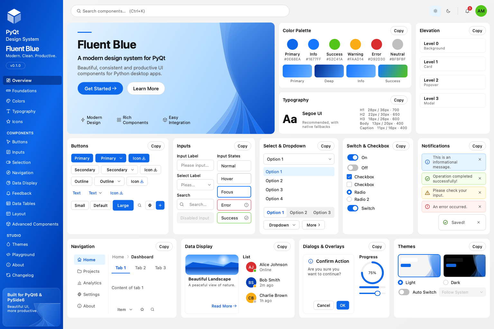
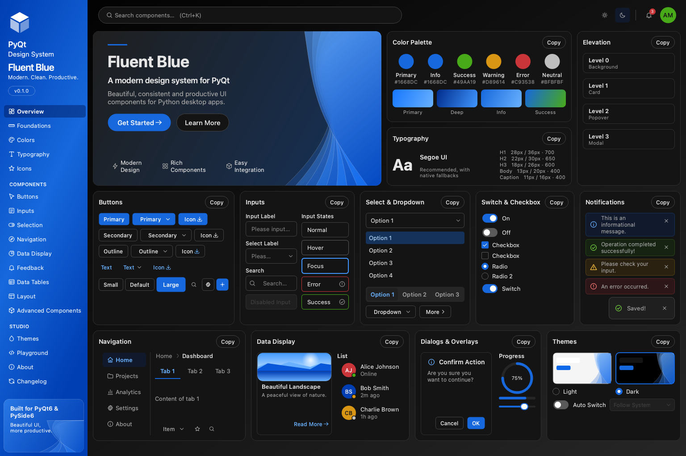
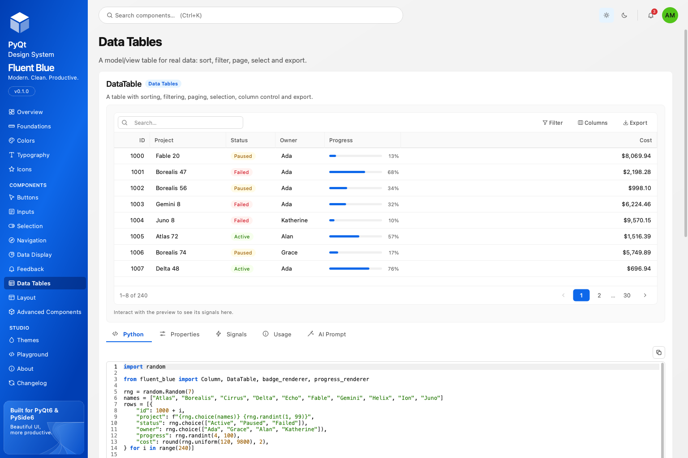
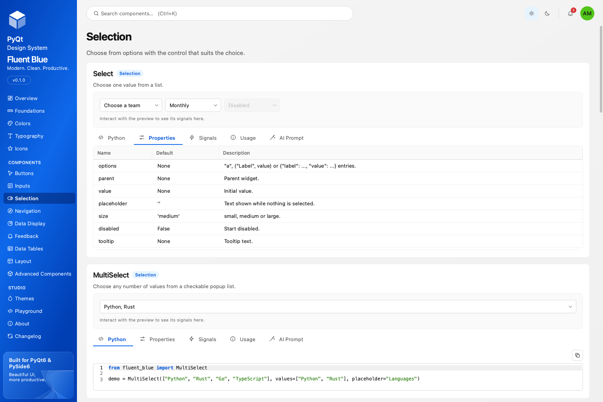

<p align="center">
  
</p>

<h1 align="center">Fluent Blue</h1>

<p align="center">
  A modern, token-driven design system for Python desktop applications.<br>
  One code base, two bindings: <b>PyQt6</b> and <b>PySide6</b>.
</p>

<p align="center">
  <a href="https://github.com/your-github-user/fluent-blue/actions/workflows/ci.yml"></a>
  
  
  
  
</p>

---

Fluent Blue gives a Qt application the consistency of a real design system: a central set of design tokens, a runtime theme engine, an original icon set, and more than a hundred components that all read from the same tokens. It ships with **Design Studio**, an interactive showcase where every example is a live widget, and with **AI agent briefs** so coding assistants can use the library without inventing APIs.

## Highlights

- **103 components** across buttons, inputs, selection, navigation, data display, data tables, feedback, layout and advanced widgets such as `DataTable`, `CommandPalette`, `CodeEditor`, `DatePicker`, `ColorPicker`, `Wizard` and `RichTextEditor`.
- **Design tokens** for color, typography, spacing, radius, elevation and motion. Components never hardcode a color.
- **Runtime themes**: light, dark and high-contrast built in; register your own with one call. Switching restyles every open window in about 80 ms.
- **Accessible by measurement**: every text pairing meets WCAG AA (4.5:1), checked by tests; keyboard access and visible focus everywhere.
- **Original SVG icons** (131) on a 24 px grid, recolored by the theme and cached.
- **Design Studio**: a premium showcase application with live previews, properties, signals, copyable code and an *AI Prompt* tab per component.
- **Honest quality gates**: 748 tests on both bindings, a UI audit that measures clipped text, overlaps and contrast on every page, and a performance report.

<p align="center">
  
  
</p>

## Installation

Pick one Qt binding. Fluent Blue never imports both in one process.

```bash
pip install "fluent-blue[pyqt6]"
# or
pip install "fluent-blue[pyside6]"
```

Then open the showcase:

```bash
fluent-blue-studio
```

Verified with Python 3.11 and 3.13 on Qt 6.12 (PyQt6 6.12.0, PySide6 6.12.0). Older Qt 6.5+ releases should work but have not been exercised by the test suite.

## Quick start

```python
from fluent_blue import Badge, Button, Card, Input, ThemeManager
from fluent_blue.compatibility.qt import QApplication, QVBoxLayout, QWidget

app = QApplication([])
ThemeManager.set_theme("light")

window = QWidget()
layout = QVBoxLayout(window)

card = Card()
card_layout = QVBoxLayout(card)
card_layout.addWidget(Input(placeholder="Enter your name..."))
card_layout.addWidget(Button("Get Started", variant="primary", size="large"))
card_layout.addWidget(Badge("New", variant="success"))

layout.addWidget(card)
window.show()
app.exec()
```

Import components from `fluent_blue` and Qt classes from `fluent_blue.compatibility.qt`, which re-exports the active binding. The same file runs unchanged on PyQt6 and PySide6.

## Tutorial: a small Projects app in five steps

The complete file lives in [`examples/projects_app.py`](examples/projects_app.py) and is run by the test suite, so it cannot drift from the library.

**1. The shell.** A `Sidebar` on the left and a `QStackedWidget` on the right is the shape of most desktop tools.

```python
from fluent_blue import Sidebar, ThemeManager
from fluent_blue.compatibility.qt import QHBoxLayout, QStackedWidget, QWidget

root = QWidget()
row = QHBoxLayout(root)
row.setContentsMargins(0, 0, 0, 0)

sidebar = Sidebar(width=220)
sidebar.add_section("Workspace")
sidebar.add_item("Projects", icon="layers")
sidebar.add_item("Settings", icon="settings")

pages = QStackedWidget()
row.addWidget(sidebar)
row.addWidget(pages, 1)
sidebar.current_changed.connect(lambda key: pages.setCurrentIndex(sidebar.keys().index(key)))
```

**2. A page with real data.** `DataTable` is built on Qt's model/view framework: sorting, filtering, paging, selection and export come for free. Cell renderers draw status pills and progress bars.

```python
from fluent_blue import Column, DataTable, badge_renderer, progress_renderer

rows = [{"name": "Atlas", "status": "Active", "progress": 72}, {"name": "Borealis", "status": "Paused", "progress": 18}]
table = DataTable([
    Column("name", width=200),
    Column("status", width=120, filterable=True, renderer=badge_renderer({"Active": "success", "Paused": "warning"})),
    Column("progress", renderer=progress_renderer()),
], rows, page_size=25, selection="single")
```

**3. Editing in a drawer.** `FormField` adds a label, helper text and validation to any input. A `Drawer` keeps the table in view while editing.

```python
from fluent_blue import Button, Drawer, FormField, Input

def edit(row):
    drawer = Drawer(root, title=f"Edit {row['name']}")
    name = FormField("Name", Input(row["name"]), required=True,
                     validator=lambda value: None if value.strip() else "A name is required.")
    drawer.add(name)
    save = drawer.add(Button("Save", variant="primary"))
    drawer.body.addStretch(1)
    save.clicked.connect(lambda: name.validate() and drawer.close_drawer())
    drawer.open_drawer()

table.row_activated.connect(edit)
```

**4. Feedback that fits the moment.** Toasts for confirmation, a `ConfirmDialog` for anything destructive, a `Snackbar` with undo for reversible actions.

```python
from fluent_blue import ConfirmDialog, Snackbar, Toast

def archive():
    if ConfirmDialog.ask(root, "Archive selected projects?", "You can restore them from the archive.", confirm_text="Archive"):
        Snackbar.show("Projects archived", parent=root, action_text="Undo", on_action=lambda: Toast.show("Restored", parent=root))
```

**5. Theme and ship.** Themes apply to every open widget at runtime. Users can follow the operating system with `"system"`.

```python
ThemeManager.set_theme("dark")        # or "light", "high-contrast", "system"
ThemeManager.register_theme("brand", {"base": "light", "colors": {"primary": "#7C3AED"}})
ThemeManager.set_theme("brand")       # the full primary ramp is derived from one color
```

## Theming

```python
from fluent_blue import ThemeManager, configure

ThemeManager.set_theme("dark")
ThemeManager.toggle()                                   # light <-> dark
ThemeManager.theme_changed.connect(lambda name: print("now", name))

ThemeManager.register_theme("ocean", {
    "base": "dark",
    "colors": {"primary": "#0EA5E9", "background": "#06121C", "surface": "#0B1A27", "text_primary": "#E6F4FF"},
    "tokens": {"radius": {"md": 8, "lg": 12}},
})
configure(font_scale=1.15, animations=False)            # scalable type, reduced motion
```

Read tokens anywhere: `ThemeManager.color("text-secondary")`, `ThemeManager.qcolor("primary")`, `ThemeManager.spacing(4)`, `ThemeManager.radius("lg")`, `ThemeManager.font("heading-2")`. Custom widgets subclass `ThemedMixin`, call `bind_theme()` and rebuild cached assets in `refresh_theme()`.

## Design Studio

`fluent-blue-studio` opens the showcase: an Overview board, Foundations, Colors, Typography and Icons references, one page per component group, a Themes page with a custom theme builder, and a Playground that runs any example as editable code. Press **Ctrl+K** to jump to a component.

Every component section has five tabs: a copyable Python example, Properties and Signals generated from the source, Usage guidance and an **AI Prompt** that gives a coding agent the exact API.

<p align="center">
  
</p>

## Working with AI coding agents

Fluent Blue ships briefs that describe each component from its own source, so an assistant cannot hallucinate parameters:

- [`AGENTS.md`](AGENTS.md): rules of the library and an index of every component brief.
- [`docs/ai/components/*.md`](docs/ai/components): one brief per component, with signature, parameters, signals, methods and a verified example.
- [`llms.txt`](llms.txt): a machine-readable index.

```bash
python -m fluent_blue.agent_prompts Button          # print a brief
python -m fluent_blue.agent_prompts --export .      # regenerate all briefs after an API change
```

A test fails if the committed briefs fall behind the code.

## Component catalog

| Group | Components |
| --- | --- |
| Buttons | `Button`, `PrimaryButton`, `SecondaryButton`, `OutlineButton`, `GhostButton`, `TextButton`, `DangerButton`, `IconButton`, `LoadingButton`, `SplitButton` |
| Inputs | `Input`, `PasswordInput`, `SearchInput`, `NumberInput`, `TextArea`, `ClearableInput`, `InputGroup`, `FormField`, `OtpInput`, `TagInput` |
| Selection | `Select`, `MultiSelect`, `ComboBox`, `Checkbox`, `RadioButton`, `RadioGroup`, `Switch`, `SegmentedControl`, `Slider`, `SpinBox` |
| Navigation | `Sidebar`, `SidebarItem`, `NavigationBar`, `Breadcrumb`, `Tabs`, `TabBar`, `Pagination`, `Menu`, `MenuItem`, `DropdownMenu`, `CommandPalette` |
| Data display | `Card`, `StatisticCard`, `Badge`, `BadgeOverlay`, `Tag`, `Avatar`, `AvatarGroup`, `Divider`, `Tooltip`, `Popover`, `ProgressBar`, `CircularProgress`, `Skeleton`, `EmptyState`, `Result`, `Timeline`, `ListItem`, `Text`, `ConsoleWidget` |
| Data tables | `DataTable`, `Column`, `DataTableModel`, `badge_renderer`, `progress_renderer` |
| Feedback | `Alert`, `Toast`, `Notification`, `Snackbar`, `MessageDialog`, `ConfirmDialog`, `LoadingOverlay`, `ProgressDialog` |
| Layout | `Container`, `Stack`, `Grid`, `Splitter`, `Panel`, `Drawer`, `Modal`, `CollapsiblePanel`, `ScrollArea`, `FluentWindow`, `TitleBar` |
| Advanced | `DatePicker`, `Calendar`, `TimePicker`, `ColorPicker`, `FilePicker`, `ImageViewer`, `CodeEditor`, `LogViewer`, `TreeView`, `FileTree`, `Stepper`, `Wizard`, `RichTextEditor` |

Full documentation, with a screenshot and the API of each component, is in [`docs/`](docs/index.md) and builds with MkDocs Material.

## Architecture

```
fluent_blue/
├── compatibility/   one import point for the active Qt binding
├── core/            tokens, palette math, typography, theme engine, animations
├── themes/          stylesheet generators, one module per component group
├── icons/           original SVG set, rendering and registration
├── components/      buttons, inputs, selection, navigation, display, feedback, data, layout, advanced
├── studio/          Design Studio application and the component catalog
└── agent_prompts.py briefs for AI coding agents, generated from the source
```

The theme engine generates one application stylesheet per theme and applies it once; custom-painted widgets read token colors at paint time. A theme switch therefore restyles the whole tree in a single pass, and hidden widgets refresh lazily when they are next shown.

## Development

```bash
git clone https://github.com/your-github-user/fluent-blue
cd fluent-blue
python -m venv .venv && source .venv/bin/activate
pip install -e ".[dev,pyqt6]"          # or pyside6; use two venvs to test both

pytest                                  # 748 tests, headless
QT_QPA_PLATFORM=offscreen python scripts/ui_audit.py --deep   # clipped text, overlaps, contrast on every page
python scripts/perf_report.py           # startup, page, theme switch and toast timings
python -m fluent_blue.agent_prompts --export .                # refresh AI briefs
python scripts/generate_docs.py         # refresh component docs and screenshots
mkdocs serve                            # documentation site
ruff check .
```

To run the suite on the other binding, install it in a second environment and set `FLUENT_BLUE_QT_BINDING=PySide6`. Each test run must pass on both before a change is merged; CI does this on Linux, Windows and macOS.

Packaging:

```bash
python -m build
twine check dist/*
```

## Project status

Fluent Blue is at version 0.1.0. The public API follows semantic versioning: breaking changes bump the minor version until 1.0, and every change is recorded in [`CHANGELOG.md`](CHANGELOG.md). See [`CONTRIBUTING.md`](CONTRIBUTING.md) for how to propose components, [`SECURITY.md`](SECURITY.md) for reporting vulnerabilities and [`CODE_OF_CONDUCT.md`](CODE_OF_CONDUCT.md) for community expectations.

## License and independence

Fluent Blue is released under the [MIT License](LICENSE). The icon set and artwork are original. The project is independent: it is not affiliated with, or endorsed by, Microsoft, The Qt Company, Riverbank Computing or Ant Group. The primary blue scale overlaps with values from Ant Design's MIT-licensed palette; everything else in the visual language was designed for this project.
