# Advanced Components

Pickers, editors, viewers, trees and multi-step flows.

Every example below is executed by the test suite on PyQt6 and PySide6, in each built-in theme.

## Calendar

A month view. Arrow keys move, Enter selects and Page Up/Down change the month.

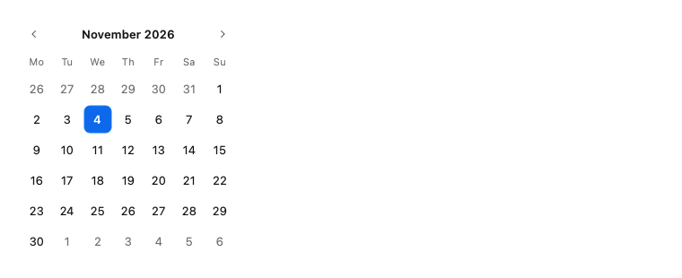

```python
import datetime as dt

from fluent_blue import Calendar

demo = Calendar(selected=dt.date(2026, 11, 4), minimum=dt.date(2026, 1, 1))
```

**Properties**

| Name | Default | Description |
| --- | --- | --- |
| `parent` | `None` | Parent widget. |
| `selected` | `None` | Initially selected date. |
| `minimum` | `None` | Earliest selectable date. |
| `maximum` | `None` | Latest selectable date. |

**Signals**

- `date_selected(object)`: The chosen datetime.date.
- `month_changed(int, int)`: The visible year and month.

**Best practices**

- Set minimum and maximum, so that invalid dates cannot be chosen at all.

[AI brief for Calendar](../ai/components/Calendar.md){ .md-button }

## DatePicker

A date field with a popup calendar.

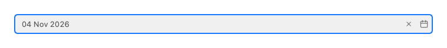

```python
import datetime as dt

from fluent_blue import DatePicker

demo = DatePicker(date=dt.date(2026, 11, 4), display_format="%d %b %Y")
```

**Properties**

| Name | Default | Description |
| --- | --- | --- |
| `parent` | `None` | Parent widget. |
| `date` | `None` | Initial datetime.date. |
| `display_format` | `'%Y-%m-%d'` | strftime format for the text. |
| `minimum` | `None` | Earliest selectable date. |
| `maximum` | `None` | Latest selectable date. |
| `placeholder` | `'Select date'` | Placeholder text. |
| `text` | `''` | Initial text. |
| `size` | `'medium'` | small, medium or large. |
| `prefix_icon` | `None` | Icon name at the start. |
| `suffix_icon` | `None` | Icon name at the end. |
| `clearable` | `False` | Show a clear button while the field has text. |
| `validation` | `'none'` | none, error, warning or success. |
| `read_only` | `False` | Selectable but not editable. |
| `disabled` | `False` | Start disabled. |
| `tooltip` | `None` | Tooltip text. |
| `accessible_name` | `None` | Name for assistive technology; defaults to the placeholder. |

**Signals**

- `date_changed(object)`: The new date, or None when cleared.
- `cleared()`: The clear button was used. Inherits textChanged, editingFinished and returnPressed from QLineEdit.

**Best practices**

- Use a clear, unambiguous format, such as 04 Nov 2026.

[AI brief for DatePicker](../ai/components/DatePicker.md){ .md-button }

## TimePicker

A time field with hour and minute columns.

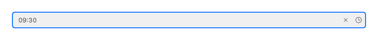

```python
import datetime as dt

from fluent_blue import TimePicker

demo = TimePicker(time=dt.time(9, 30), minute_step=15)
```

**Properties**

| Name | Default | Description |
| --- | --- | --- |
| `parent` | `None` | Parent widget. |
| `time` | `None` | Initial datetime.time. |
| `minute_step` | `5` | Minute granularity. |
| `display_format` | `'%H:%M'` | strftime format for the text. |
| `placeholder` | `'Select time'` | Placeholder text. |
| `text` | `''` | Initial text. |
| `size` | `'medium'` | small, medium or large. |
| `prefix_icon` | `None` | Icon name at the start. |
| `suffix_icon` | `None` | Icon name at the end. |
| `clearable` | `False` | Show a clear button while the field has text. |
| `validation` | `'none'` | none, error, warning or success. |
| `read_only` | `False` | Selectable but not editable. |
| `disabled` | `False` | Start disabled. |
| `tooltip` | `None` | Tooltip text. |
| `accessible_name` | `None` | Name for assistive technology; defaults to the placeholder. |

**Signals**

- `time_changed(object)`: The new time, or None when cleared.
- `cleared()`: The clear button was used. Inherits textChanged, editingFinished and returnPressed from QLineEdit.

**Best practices**

- Match minute_step to how precise the task really is.

[AI brief for TimePicker](../ai/components/TimePicker.md){ .md-button }

## ColorPicker

A swatch button that opens a saturation/value square, hue bar, hex field and presets.

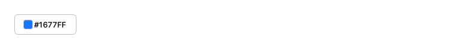

```python
from fluent_blue import ColorPicker

demo = ColorPicker(color="#1677FF")
```

**Properties**

| Name | Default | Description |
| --- | --- | --- |
| `parent` | `None` | Parent widget. |
| `color` | `'#1677FF'` | Initial color as #RRGGBB. |
| `presets` | `('primary-500', 'primary-300', 'primary-800', 'success', 'warning', 'error', 'info', 'gray-500', 'gray-900')` | Hex values or color roles offered as shortcuts. |
| `text` | `''` | Button label. |
| `variant` | `None` | primary, secondary, outline, ghost, text or danger. |
| `size` | `'medium'` | small, medium or large. |
| `icon` | `None` | Icon name or QIcon. |
| `icon_position` | `'left'` | left or right. |
| `loading` | `False` | Show a spinner and ignore clicks. |
| `disabled` | `False` | Start disabled. |
| `full_width` | `False` | Expand to fill the available width. |
| `tooltip` | `None` | Tooltip text. |

**Signals**

- `color_changed(str)`: The new color as uppercase #RRGGBB.

**Best practices**

- Presets accept color roles, so they follow the active theme.

[AI brief for ColorPicker](../ai/components/ColorPicker.md){ .md-button }

## FilePicker

A path field with a browse button and drag and drop.

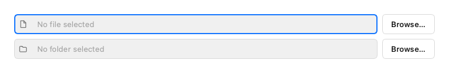

```python
from fluent_blue import FilePicker, Stack

demo = Stack([FilePicker(filter="Images (*.png *.jpg)"), FilePicker(mode="directory", placeholder="No folder selected")])
```

**Properties**

| Name | Default | Description |
| --- | --- | --- |
| `parent` | `None` | Parent widget. |
| `mode` | `'open'` | open, open-multiple, save or directory. |
| `filter` | `''` | Qt name filter, such as "Images (*.png *.jpg)". |
| `placeholder` | `'No file selected'` | Placeholder text. |
| `button_text` | `'Browse…'` | Label of the browse button. |
| `disabled` | `False` | Start disabled. |

**Signals**

- `file_selected(str)`: A path was chosen, the first one in multiple mode.
- `files_selected(list)`: All chosen paths.

**Best practices**

- Files can also be dropped onto the control.

[AI brief for FilePicker](../ai/components/FilePicker.md){ .md-button }

## ImageViewer

An image viewer with zoom, pan, rotate and fit.

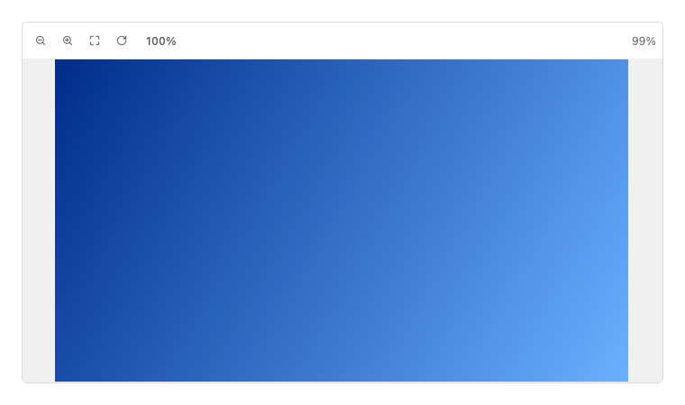

```python
from fluent_blue import ImageViewer, ThemeManager
from fluent_blue.compatibility.qt import QLinearGradient, QPainter, QPixmap

picture = QPixmap(640, 360)
painter = QPainter(picture)
gradient = QLinearGradient(0, 0, 640, 360)
gradient.setColorAt(0, ThemeManager.qcolor("primary-800"))
gradient.setColorAt(1, ThemeManager.qcolor("primary-300"))
painter.fillRect(picture.rect(), gradient)
painter.end()
demo = ImageViewer(picture)
demo.setMinimumHeight(280)
```

**Properties**

| Name | Default | Description |
| --- | --- | --- |
| `image` | `None` | Path or QPixmap. |
| `parent` | `None` | Parent widget. |
| `min_zoom` | `0.05` | Lowest zoom factor. |
| `max_zoom` | `16.0` | Highest zoom factor. |

**Signals**

- `zoom_changed(float)`: The new zoom factor.

**Best practices**

- The mouse wheel zooms under the cursor, and dragging pans the image.

[AI brief for ImageViewer](../ai/components/ImageViewer.md){ .md-button }

## CodeEditor

A code editor with line numbers, syntax colors and smart indentation.

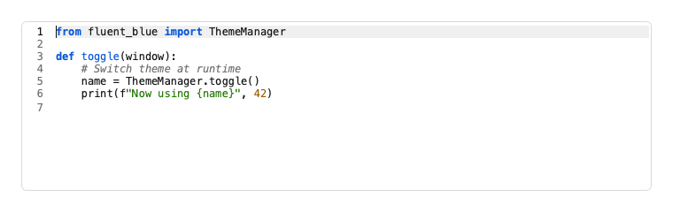

```python
from fluent_blue import CodeEditor

demo = CodeEditor("""from fluent_blue import ThemeManager

def toggle(window):
    # Switch theme at runtime
    name = ThemeManager.toggle()
    print(f"Now using {name}", 42)
""", language="python")
demo.setMinimumHeight(170)
```

**Properties**

| Name | Default | Description |
| --- | --- | --- |
| `text` | `''` | Initial content. |
| `parent` | `None` | Parent widget. |
| `language` | `'python'` | python, json, sql or text. |
| `read_only` | `False` | Disable editing. |
| `line_numbers` | `True` | Show the gutter. |
| `tab_width` | `4` | Spaces per indent level. |

**Signals**

- `code_changed(str)`: The content changed.

**Best practices**

- Tab inserts spaces, and Enter keeps the indentation level.
- Use read_only=True to display code.

[AI brief for CodeEditor](../ai/components/CodeEditor.md){ .md-button }

## LogViewer

A live log view with level filtering, search and tailing.

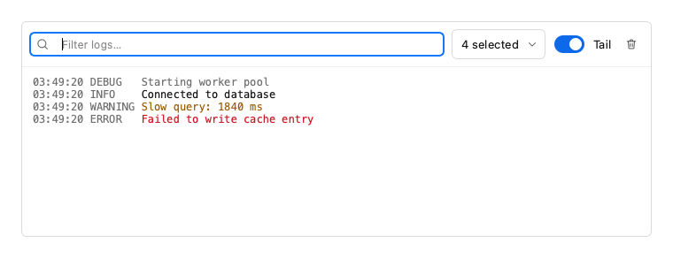

```python
from fluent_blue import LogViewer

demo = LogViewer()
demo.log("Starting worker pool", "debug")
demo.log("Connected to database", "info")
demo.log("Slow query: 1840 ms", "warning")
demo.log("Failed to write cache entry", "error")
demo.setMinimumHeight(200)
```

**Properties**

| Name | Default | Description |
| --- | --- | --- |
| `parent` | `None` | Parent widget. |
| `max_entries` | `10000` | Retained entries; the oldest are dropped first. |
| `timestamps` | `True` | Prefix each entry with its time. |

**Signals**

- `entry_added(str, str)`: The message and level of a new entry.
- `record_received()`: 

**Best practices**

- attach_logger routes Python logging here, safely from any thread.

[AI brief for LogViewer](../ai/components/LogViewer.md){ .md-button }

## TreeView

A tree from nested dicts, with built-in filtering.

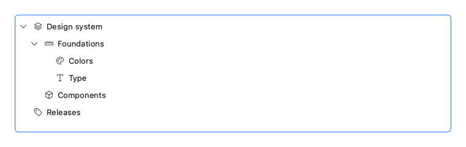

```python
from fluent_blue import TreeView

demo = TreeView([
    {"text": "Design system", "icon": "layers", "children": [
        {"text": "Foundations", "icon": "ruler", "children": [{"text": "Colors", "icon": "palette"}, {"text": "Type", "icon": "type"}]},
        {"text": "Components", "icon": "box"},
    ]},
    {"text": "Releases", "icon": "tag"},
])
demo.setMinimumHeight(190)
```

**Properties**

| Name | Default | Description |
| --- | --- | --- |
| `items` | `None` | Dicts with text and optional id, icon and children. |
| `parent` | `None` | Parent widget. |
| `expand_all` | `True` | Expand every node initially. |

**Signals**

- `item_selected(object)`: The id of the current item.
- `item_activated(object)`: The id of an item activated by double-click or Enter.

**Best practices**

- set_filter keeps matching items along with their ancestors, so context is kept.

[AI brief for TreeView](../ai/components/TreeView.md){ .md-button }

## FileTree

A lazily loaded file system tree, using QFileSystemModel.

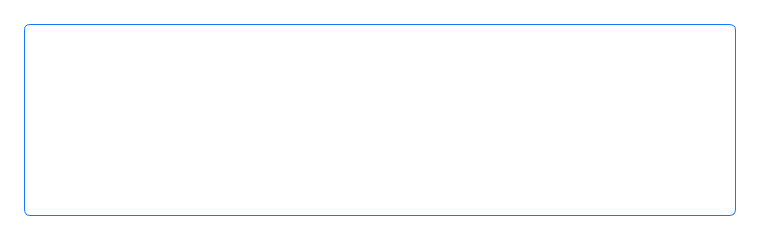

```python
from pathlib import Path

import fluent_blue
from fluent_blue import FileTree

demo = FileTree(str(Path(fluent_blue.__file__).parent), name_filters=["*.py"])
demo.setMinimumHeight(190)
```

**Properties**

| Name | Default | Description |
| --- | --- | --- |
| `root` | `''` | Root directory. |
| `parent` | `None` | Parent widget. |
| `name_filters` | `None` | Patterns such as ["*.py"]; others are hidden. |

**Signals**

- `file_selected(str)`: The path of the current item.
- `file_activated(str)`: The path of a file activated by double-click or Enter.

**Best practices**

- Directories load lazily, so large folders stay fast.

[AI brief for FileTree](../ai/components/FileTree.md){ .md-button }

## Stepper

Shows progress through ordered steps. Arrow keys move when clickable.

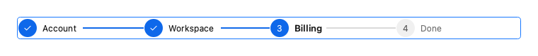

```python
from fluent_blue import Stepper

demo = Stepper(["Account", "Workspace", "Billing", "Done"], current=2, clickable=True)
```

**Properties**

| Name | Default | Description |
| --- | --- | --- |
| `steps` | `None` | Step titles. |
| `parent` | `None` | Parent widget. |
| `current` | `0` | Current 0-based step. |
| `clickable` | `False` | Allow moving to completed steps by mouse and keyboard. |

**Signals**

- `current_changed(int)`: The current step changed.
- `step_clicked(int)`: A step was chosen by the user.

**Best practices**

- Keep to three to six steps with short titles.

[AI brief for Stepper](../ai/components/Stepper.md){ .md-button }

## Wizard

A multi-step flow with a stepper, validation and navigation.

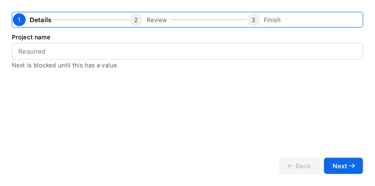

```python
from fluent_blue import FormField, Input, Result, Text, Wizard

demo = Wizard()
name = Input(placeholder="Required")
field = FormField("Project name", name, helper="Next is blocked until this has a value.")

def check():
    field.set_error("" if name.text() else "Enter a project name.")
    return bool(name.text())

demo.add_page("Details", field, check)
demo.add_page("Review", Text("Check your details, then continue.", color="text-secondary"))
demo.add_page("Finish", Result("success", "All set", description="Your project is ready."))
demo.setMinimumHeight(330)
```

**Properties**

| Name | Default | Description |
| --- | --- | --- |
| `parent` | `None` | Parent widget. |
| `finish_text` | `'Finish'` | Label of the last step's button. |
| `cancelable` | `False` | Show a cancel button. |

**Signals**

- `page_changed(int)`: The current page changed.
- `finished()`: The last page was completed.
- `cancelled()`: The cancel button was used.

**Best practices**

- Validate on Next so that errors appear in context, on the step that caused them.

[AI brief for Wizard](../ai/components/Wizard.md){ .md-button }

## RichTextEditor

A rich text editor with a formatting toolbar.

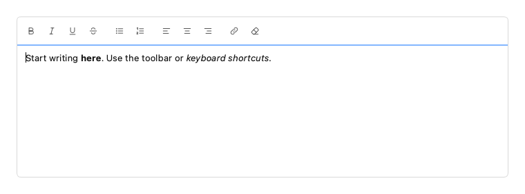

```python
from fluent_blue import RichTextEditor

demo = RichTextEditor(html="<p>Start writing <b>here</b>. Use the toolbar or <i>keyboard shortcuts</i>.</p>")
demo.setMinimumHeight(180)
```

**Properties**

| Name | Default | Description |
| --- | --- | --- |
| `parent` | `None` | Parent widget. |
| `html` | `''` | Initial HTML content. |
| `placeholder` | `'Write something…'` | Placeholder text. |
| `read_only` | `False` | Hide the toolbar and disable editing. |

**Signals**

- `content_changed()`: The document changed.

**Best practices**

- Store to_html or to_markdown, depending on what your backend needs.

[AI brief for RichTextEditor](../ai/components/RichTextEditor.md){ .md-button }
