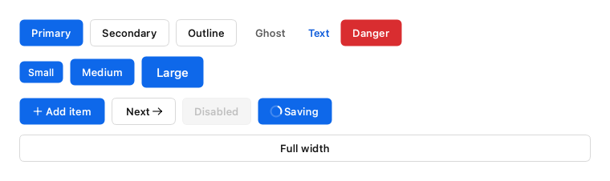
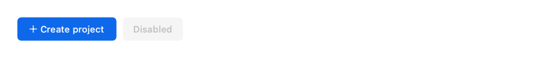
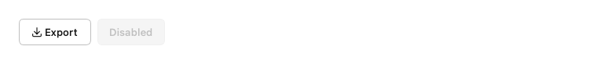
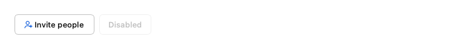
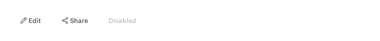
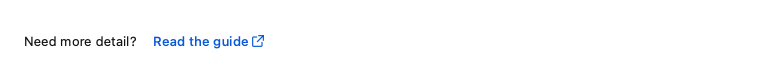
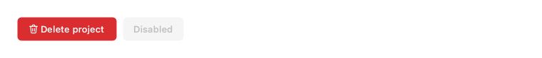
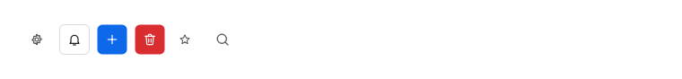
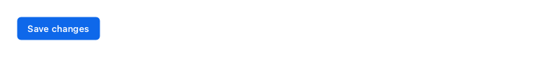
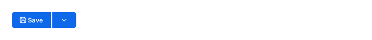

# Buttons

Actions, from the single primary path to quiet toolbar controls.

Every example below is executed by the test suite on PyQt6 and PySide6, in each built-in theme.

## Button

A push button with variants, sizes, icons and a loading state.



```python
from fluent_blue import Button, Stack

row = lambda *items: Stack(items, direction="horizontal", spacing=2, align="center")
demo = Stack([
    row(*[Button(v.title(), variant=v) for v in ("primary", "secondary", "outline", "ghost", "text", "danger")]),
    row(Button("Small", size="small", variant="primary"), Button("Medium", variant="primary"),
        Button("Large", size="large", variant="primary")),
    row(Button("Add item", icon="plus", variant="primary"), Button("Next", icon="arrow-right", icon_position="right"),
        Button("Disabled", disabled=True), Button("Saving", loading=True, variant="primary")),
    Button("Full width", variant="outline", full_width=True),
], spacing=3)
```

**Properties**

| Name | Default | Description |
| --- | --- | --- |
| `text` | `''` | Button label. |
| `parent` | `None` | Parent widget. |
| `variant` | `None` | primary, secondary, outline, ghost, text or danger. |
| `size` | `'medium'` | small, medium or large. |
| `icon` | `None` | Icon name or QIcon. |
| `icon_position` | `'left'` | left or right. |
| `loading` | `False` | Show a spinner and ignore clicks. |
| `disabled` | `False` | Start disabled. |
| `full_width` | `False` | Expand to fill the available width. |
| `tooltip` | `None` | Tooltip text. |

**Best practices**

- Use one primary button per view; it marks the main path.
- Label buttons with a verb that names the outcome, such as “Save changes”.

[AI brief for Button](../ai/components/Button.md){ .md-button }

## PrimaryButton

The single most important action in a view.



```python
from fluent_blue import PrimaryButton, Stack

demo = Stack([PrimaryButton("Create project", icon="plus"), PrimaryButton("Disabled", disabled=True)],
             direction="horizontal")
```

**Properties**

| Name | Default | Description |
| --- | --- | --- |
| `text` | `''` | Button label. |
| `parent` | `None` | Parent widget. |
| `variant` | `None` | primary, secondary, outline, ghost, text or danger. |
| `size` | `'medium'` | small, medium or large. |
| `icon` | `None` | Icon name or QIcon. |
| `icon_position` | `'left'` | left or right. |
| `loading` | `False` | Show a spinner and ignore clicks. |
| `disabled` | `False` | Start disabled. |
| `full_width` | `False` | Expand to fill the available width. |
| `tooltip` | `None` | Tooltip text. |

**Best practices**

- Reserve it for the action most users came to do.
- Pair it with a secondary button for the alternative.

[AI brief for PrimaryButton](../ai/components/PrimaryButton.md){ .md-button }

## SecondaryButton

A standard action. This is the default look of Button.



```python
from fluent_blue import SecondaryButton, Stack

demo = Stack([SecondaryButton("Export", icon="download"), SecondaryButton("Disabled", disabled=True)],
             direction="horizontal")
```

**Properties**

| Name | Default | Description |
| --- | --- | --- |
| `text` | `''` | Button label. |
| `parent` | `None` | Parent widget. |
| `variant` | `None` | primary, secondary, outline, ghost, text or danger. |
| `size` | `'medium'` | small, medium or large. |
| `icon` | `None` | Icon name or QIcon. |
| `icon_position` | `'left'` | left or right. |
| `loading` | `False` | Show a spinner and ignore clicks. |
| `disabled` | `False` | Start disabled. |
| `full_width` | `False` | Expand to fill the available width. |
| `tooltip` | `None` | Tooltip text. |

**Best practices**

- The right default for most actions.
- Several can sit side by side without competing.

[AI brief for SecondaryButton](../ai/components/SecondaryButton.md){ .md-button }

## OutlineButton

A brand-tinted action with less weight than PrimaryButton.



```python
from fluent_blue import OutlineButton, Stack

demo = Stack([OutlineButton("Invite people", icon="user-plus"), OutlineButton("Disabled", disabled=True)],
             direction="horizontal")
```

**Properties**

| Name | Default | Description |
| --- | --- | --- |
| `text` | `''` | Button label. |
| `parent` | `None` | Parent widget. |
| `variant` | `None` | primary, secondary, outline, ghost, text or danger. |
| `size` | `'medium'` | small, medium or large. |
| `icon` | `None` | Icon name or QIcon. |
| `icon_position` | `'left'` | left or right. |
| `loading` | `False` | Show a spinner and ignore clicks. |
| `disabled` | `False` | Start disabled. |
| `full_width` | `False` | Expand to fill the available width. |
| `tooltip` | `None` | Tooltip text. |

**Best practices**

- Use for a brand-tinted action that should not outrank the primary button.

[AI brief for OutlineButton](../ai/components/OutlineButton.md){ .md-button }

## GhostButton

A low-emphasis action for toolbars and dense layouts.



```python
from fluent_blue import GhostButton, Stack

demo = Stack([GhostButton("Edit", icon="edit"), GhostButton("Share", icon="share"), GhostButton("Disabled", disabled=True)],
             direction="horizontal")
```

**Properties**

| Name | Default | Description |
| --- | --- | --- |
| `text` | `''` | Button label. |
| `parent` | `None` | Parent widget. |
| `variant` | `None` | primary, secondary, outline, ghost, text or danger. |
| `size` | `'medium'` | small, medium or large. |
| `icon` | `None` | Icon name or QIcon. |
| `icon_position` | `'left'` | left or right. |
| `loading` | `False` | Show a spinner and ignore clicks. |
| `disabled` | `False` | Start disabled. |
| `full_width` | `False` | Expand to fill the available width. |
| `tooltip` | `None` | Tooltip text. |

**Best practices**

- Best in toolbars and dense rows, where borders would add noise.

[AI brief for GhostButton](../ai/components/GhostButton.md){ .md-button }

## TextButton

A link-like action, typically inline with content.



```python
from fluent_blue import Stack, Text, TextButton

demo = Stack([Text("Need more detail?"), TextButton("Read the guide", icon="external-link", icon_position="right")],
             direction="horizontal", align="center")
```

**Properties**

| Name | Default | Description |
| --- | --- | --- |
| `text` | `''` | Button label. |
| `parent` | `None` | Parent widget. |
| `variant` | `None` | primary, secondary, outline, ghost, text or danger. |
| `size` | `'medium'` | small, medium or large. |
| `icon` | `None` | Icon name or QIcon. |
| `icon_position` | `'left'` | left or right. |
| `loading` | `False` | Show a spinner and ignore clicks. |
| `disabled` | `False` | Start disabled. |
| `full_width` | `False` | Expand to fill the available width. |
| `tooltip` | `None` | Tooltip text. |

**Best practices**

- Use inline with content, like a link that triggers an action.

[AI brief for TextButton](../ai/components/TextButton.md){ .md-button }

## DangerButton

A destructive action, such as deleting data.



```python
from fluent_blue import DangerButton, Stack

demo = Stack([DangerButton("Delete project", icon="trash"), DangerButton("Disabled", disabled=True)],
             direction="horizontal")
```

**Properties**

| Name | Default | Description |
| --- | --- | --- |
| `text` | `''` | Button label. |
| `parent` | `None` | Parent widget. |
| `variant` | `None` | primary, secondary, outline, ghost, text or danger. |
| `size` | `'medium'` | small, medium or large. |
| `icon` | `None` | Icon name or QIcon. |
| `icon_position` | `'left'` | left or right. |
| `loading` | `False` | Show a spinner and ignore clicks. |
| `disabled` | `False` | Start disabled. |
| `full_width` | `False` | Expand to fill the available width. |
| `tooltip` | `None` | Tooltip text. |

**Best practices**

- Confirm irreversible actions with a ConfirmDialog.
- Name what is destroyed, not just “Delete”.

[AI brief for DangerButton](../ai/components/DangerButton.md){ .md-button }

## IconButton

A square icon-only button.



```python
from fluent_blue import IconButton, Stack

demo = Stack([
    IconButton("settings", tooltip="Settings"),
    IconButton("bell", variant="secondary", tooltip="Notifications"),
    IconButton("plus", variant="primary", tooltip="Add"),
    IconButton("trash", variant="danger", tooltip="Delete"),
    IconButton("star", size="small", tooltip="Favorite", checkable=True),
    IconButton("search", size="large", tooltip="Search"),
], direction="horizontal", align="center")
```

**Properties**

| Name | Default | Description |
| --- | --- | --- |
| `icon` | `required` | Icon name or QIcon. |
| `parent` | `None` | Parent widget. |
| `variant` | `None` | primary, secondary, outline, ghost, text or danger. |
| `size` | `'medium'` | small, medium or large. |
| `tooltip` | `None` | Also used as the accessible name, which an icon-only control needs. |
| `disabled` | `False` | Start disabled. |
| `loading` | `False` | Show a spinner and ignore clicks. |
| `checkable` | `False` | Toggle between checked and unchecked on each click. |

**Best practices**

- Always set a tooltip; it doubles as the accessible name.
- Only use icons whose meaning is unambiguous.

[AI brief for IconButton](../ai/components/IconButton.md){ .md-button }

## LoadingButton

A primary button with start() and stop() shortcuts for async work.



```python
from fluent_blue import LoadingButton
from fluent_blue.compatibility.qt import QTimer

demo = LoadingButton("Save changes", loading_text="Saving…")

def save():
    demo.start()
    QTimer.singleShot(1500, demo.stop)

demo.clicked.connect(save)
```

**Properties**

| Name | Default | Description |
| --- | --- | --- |
| `text` | `''` | Button label. |
| `parent` | `None` | Parent widget. |
| `loading_text` | `None` | Label to show while loading; the original label returns on stop(). |
| `variant` | `None` | primary, secondary, outline, ghost, text or danger. |
| `size` | `'medium'` | small, medium or large. |
| `icon` | `None` | Icon name or QIcon. |
| `icon_position` | `'left'` | left or right. |
| `loading` | `False` | Show a spinner and ignore clicks. |
| `disabled` | `False` | Start disabled. |
| `full_width` | `False` | Expand to fill the available width. |
| `tooltip` | `None` | Tooltip text. |

**Best practices**

- Keep the button's width stable by using a similar loading label.
- Clicks are ignored while loading, so double submission cannot happen.

[AI brief for LoadingButton](../ai/components/LoadingButton.md){ .md-button }

## SplitButton

Primary action on the left, a menu of related actions on the right.



```python
from fluent_blue import SplitButton

demo = SplitButton("Save", icon="save", items=[
    {"text": "Save as…", "icon": "file"},
    {"text": "Save a copy", "icon": "copy"},
    None,
    {"text": "Discard", "icon": "trash", "danger": True},
])
```

**Properties**

| Name | Default | Description |
| --- | --- | --- |
| `text` | `''` | Label of the main action. |
| `parent` | `None` | Parent widget. |
| `items` | `None` | Menu entries, accepted in every form Menu understands. |
| `variant` | `'primary'` | Button variant applied to both parts. |
| `size` | `'medium'` | small, medium or large. |
| `icon` | `None` | Icon of the main action. |
| `disabled` | `False` | Start disabled. |

**Signals**

- `clicked()`: The main action was activated.
- `item_triggered(str)`: A menu entry was chosen; carries its id.

**Best practices**

- The main action should be what most people want most of the time.
- Menu entries should be variations of the same task.

[AI brief for SplitButton](../ai/components/SplitButton.md){ .md-button }
