# Data Display

Present content, status and progress.

Every example below is executed by the test suite on PyQt6 and PySide6, in each built-in theme.

## Card

A content container.

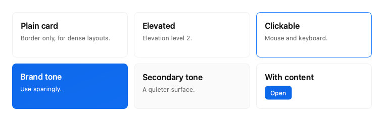

```python
from fluent_blue import Button, Card, Grid, Text

demo = Grid(columns=3)
plain = demo.add(Card(title="Plain card", subtitle="Border only, for dense layouts."))
raised = demo.add(Card(title="Elevated", subtitle="Elevation level 2.", elevation=2))
click = demo.add(Card(title="Clickable", subtitle="Mouse and keyboard.", clickable=True))
brand = demo.add(Card(tone="brand", title="Brand tone", subtitle="Use sparingly."))
second = demo.add(Card(tone="secondary", title="Secondary tone", subtitle="A quieter surface."))
action = demo.add(Card(title="With content"))
action.add(Button("Open", variant="primary", size="small"))
```

**Properties**

| Name | Default | Description |
| --- | --- | --- |
| `parent` | `None` | Parent widget. |
| `title` | `''` | Header title. |
| `subtitle` | `''` | Header subtitle. |
| `elevation` | `0` | Shadow level from 0 to 4. |
| `tone` | `'default'` | default, secondary or brand. |
| `hoverable` | `False` | Highlight the border on hover. |
| `clickable` | `False` | Make the card activatable by mouse and keyboard. |

**Signals**

- `clicked()`: A clickable card was activated.

**Best practices**

- Prefer borders in dense views; shadows are for things that float.
- Avoid nesting cards.

[AI brief for Card](../ai/components/Card.md){ .md-button }

## StatisticCard

A headline metric with trend.

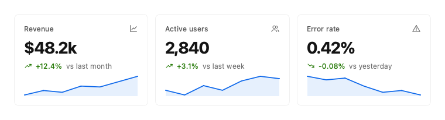

```python
from fluent_blue import Grid, StatisticCard

demo = Grid(columns=3)
demo.add(StatisticCard("Revenue", "$48.2k", delta="+12.4%", trend="up", caption="vs last month", icon="chart-line",
                       spark=[3, 4, 3.6, 5, 4.8, 6, 7.2]))
demo.add(StatisticCard("Active users", "2,840", delta="+3.1%", trend="up", caption="vs last week", icon="users",
                       spark=[6, 5.8, 6.2, 6, 6.4, 6.6, 6.5]))
demo.add(StatisticCard("Error rate", "0.42%", delta="-0.08%", trend="down", caption="vs yesterday", icon="alert-triangle",
                       positive_is_up=False, spark=[5, 4.6, 4.8, 3.9, 3.2, 3.4, 2.9]))
```

**Properties**

| Name | Default | Description |
| --- | --- | --- |
| `title` | `''` | Metric name. |
| `value` | `''` | Formatted value. |
| `parent` | `None` | Parent widget. |
| `delta` | `''` | Change text, such as "+12.4%". |
| `trend` | `'flat'` | up, down or flat. It sets the delta color. |
| `caption` | `''` | Text after the delta, such as "vs last week". |
| `icon` | `None` | Icon name. |
| `spark` | `None` | Optional numbers for a sparkline. |
| `positive_is_up` | `True` | Set False when a falling number is good, such as error rate. |
| `subtitle` | `''` | Header subtitle. |
| `elevation` | `0` | Shadow level from 0 to 4. |
| `tone` | `'default'` | default, secondary or brand. |
| `hoverable` | `False` | Highlight the border on hover. |
| `clickable` | `False` | Make the card activatable by mouse and keyboard. |

**Signals**

- `clicked()`: A clickable card was activated.

**Best practices**

- Always give the number a comparison; a lone figure says little.
- Set positive_is_up=False for metrics where lower is better.

[AI brief for StatisticCard](../ai/components/StatisticCard.md){ .md-button }

## Text

A label bound to a typography role and a text color role.

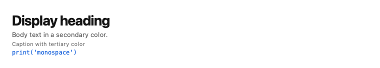

```python
from fluent_blue import Stack, Text

demo = Stack([
    Text("Display heading", style="heading-1"),
    Text("Body text in a secondary color.", color="text-secondary"),
    Text("Caption with tertiary color", style="caption", color="text-tertiary"),
    Text("print('monospace')", style="monospace", color="primary-text"),
], spacing=1)
```

**Properties**

| Name | Default | Description |
| --- | --- | --- |
| `text` | `''` | Content. |
| `parent` | `None` | Parent widget. |
| `style` | `'body-medium'` | Typography role such as heading-2 or body-medium. |
| `color` | `'text-primary'` | Text color role such as text-secondary. |
| `wrap` | `False` | Enable word wrap. |
| `selectable` | `False` | Allow mouse selection. |

**Best practices**

- Use typography roles, never ad hoc sizes, so that hierarchy stays consistent.

[AI brief for Text](../ai/components/Text.md){ .md-button }

## Badge

A small status label or dot.

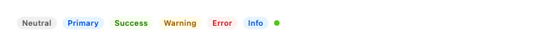

```python
from fluent_blue import Badge, Stack

demo = Stack([Badge(v.title(), variant=v) for v in ("neutral", "primary", "success", "warning", "error", "info")]
             + [Badge("Online", variant="success", dot=True)], direction="horizontal", align="center")
```

**Properties**

| Name | Default | Description |
| --- | --- | --- |
| `text` | `''` | Content; empty with dot=True. |
| `parent` | `None` | Parent widget. |
| `variant` | `'neutral'` | neutral, primary, success, warning, error or info. |
| `dot` | `False` | Render as a small dot. |

**Best practices**

- Keep text to one or two words.
- Do not rely on color alone; the label carries the meaning.

[AI brief for Badge](../ai/components/Badge.md){ .md-button }

## Tag

A compact label for categories, optionally closable.

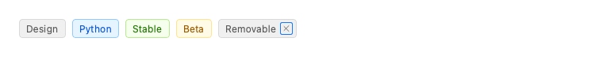

```python
from fluent_blue import Stack, Tag

demo = Stack([Tag("Design"), Tag("Python", variant="primary"), Tag("Stable", variant="success"),
              Tag("Beta", variant="warning"), Tag("Removable", closable=True)], direction="horizontal", align="center")
```

**Properties**

| Name | Default | Description |
| --- | --- | --- |
| `text` | `''` | Content. |
| `parent` | `None` | Parent widget. |
| `variant` | `'neutral'` | Same options as Badge. |
| `closable` | `False` | Show a close button. |

**Signals**

- `closed(str)`: The close button was used; carries the text. The tag hides itself.

**Best practices**

- Use tags for categories that people add or remove; use badges for status.

[AI brief for Tag](../ai/components/Tag.md){ .md-button }

## Avatar

A user image or initials.

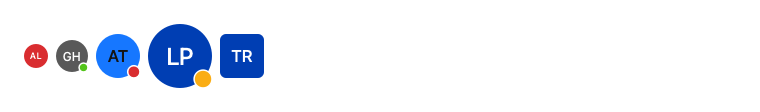

```python
from fluent_blue import Avatar, Stack

demo = Stack([Avatar("Ada Lovelace", size="small"), Avatar("Grace Hopper", status="online"),
              Avatar("Alan Turing", size="large", status="busy"), Avatar("Linus Pauling", size="xl", status="away"),
              Avatar("Team Rocket", size="large", shape="square")], direction="horizontal", align="center")
```

**Properties**

| Name | Default | Description |
| --- | --- | --- |
| `name` | `''` | Used for initials, the fallback color and the accessible name. |
| `parent` | `None` | Parent widget. |
| `image` | `None` | Image path or QPixmap. |
| `size` | `'medium'` | small, medium, large, xl or a pixel size. |
| `shape` | `'circle'` | circle or square. |
| `status` | `None` | Optional presence dot: online, away, busy or offline. |

**Best practices**

- Colors are derived from the name, so one person always looks the same.

[AI brief for Avatar](../ai/components/Avatar.md){ .md-button }

## AvatarGroup

Overlapping avatars with a "+N" overflow.

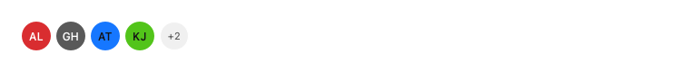

```python
from fluent_blue import AvatarGroup

demo = AvatarGroup(["Ada Lovelace", "Grace Hopper", "Alan Turing", "Katherine Johnson", "Tim Berners", "Edsger Dijkstra"],
                   max_visible=4)
```

**Properties**

| Name | Default | Description |
| --- | --- | --- |
| `names` | `None` | People to display. |
| `parent` | `None` | Parent widget. |
| `max_visible` | `4` | Avatars shown before the overflow counter. |
| `size` | `'medium'` | Avatar size name. |

**Best practices**

- The accessible name lists everyone, including those in the overflow.

[AI brief for AvatarGroup](../ai/components/AvatarGroup.md){ .md-button }

## Divider

A separator line, optionally with centered text.

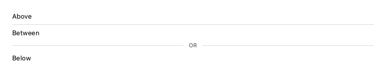

```python
from fluent_blue import Divider, Stack, Text

demo = Stack([Text("Above"), Divider(), Text("Between"), Divider("OR"), Text("Below")], spacing=2)
```

**Properties**

| Name | Default | Description |
| --- | --- | --- |
| `text` | `''` | Optional caption on a horizontal divider. |
| `parent` | `None` | Parent widget. |
| `orientation` | `'horizontal'` | horizontal or vertical. |

**Best practices**

- Prefer whitespace first; add a divider only when grouping is still unclear.

[AI brief for Divider](../ai/components/Divider.md){ .md-button }

## Tooltip

Attach a rich, delayed tooltip to a widget. It also appears on keyboard focus.

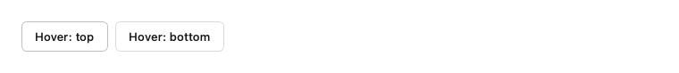

```python
from fluent_blue import Button, Stack, Tooltip

top, bottom = Button("Hover: top"), Button("Hover: bottom")
Tooltip(top, "Appears above the control")
Tooltip(bottom, "Appears below the control", placement="bottom")
demo = Stack([top, bottom], direction="horizontal")
```

**Properties**

| Name | Default | Description |
| --- | --- | --- |
| `target` | `required` | The widget to describe. |
| `text` | `required` | Tooltip text. |
| `placement` | `'top'` | top, bottom, left or right. |
| `delay_ms` | `350` | Hover time before showing. |

**Best practices**

- Tooltips supplement a label; they never hold essential information.

[AI brief for Tooltip](../ai/components/Tooltip.md){ .md-button }

## Popover

A floating panel anchored to a widget. It closes on outside click or Escape.

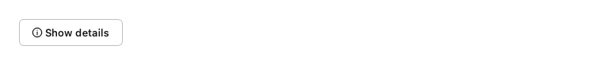

```python
from fluent_blue import Button, Popover

demo = Button("Show details", icon="info-circle")
pop = Popover(demo, title="About this metric", content="Sessions counted over the trailing 28 days, excluding internal traffic.")
demo.clicked.connect(lambda: pop.show_at(demo))
```

**Properties**

| Name | Default | Description |
| --- | --- | --- |
| `parent` | `None` | Owner widget. |
| `title` | `''` | Optional heading. |
| `content` | `None` | Text or a widget. |
| `width` | `280` | Panel width in pixels. |

**Signals**

- `closed()`: The popover was hidden.

**Best practices**

- Use for rich, secondary content on demand. Use Modal when a decision is required.

[AI brief for Popover](../ai/components/Popover.md){ .md-button }

## ProgressBar

A horizontal progress bar.

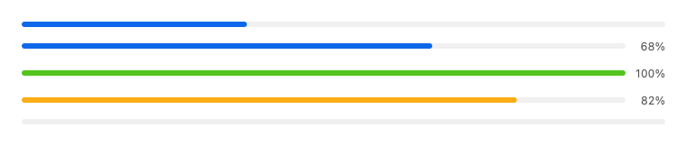

```python
from fluent_blue import ProgressBar, Stack

demo = Stack([ProgressBar(35), ProgressBar(68, show_label=True), ProgressBar(100, variant="success", show_label=True),
              ProgressBar(82, variant="warning", show_label=True), ProgressBar(indeterminate=True)], spacing=3)
```

**Properties**

| Name | Default | Description |
| --- | --- | --- |
| `value` | `0` | Current value. |
| `parent` | `None` | Parent widget. |
| `minimum` | `0` | Lower bound. |
| `maximum` | `100` | Upper bound. |
| `indeterminate` | `False` | Animate without a known value. |
| `variant` | `'primary'` | primary, success, warning, error or info. |
| `show_label` | `False` | Show the percentage at the right. |
| `thickness` | `6` | Track height in pixels. |

**Signals**

- `value_changed(float)`: The value changed.

**Best practices**

- Prefer a determinate bar whenever progress can be measured.

[AI brief for ProgressBar](../ai/components/ProgressBar.md){ .md-button }

## CircularProgress

A circular progress indicator, which also serves as a spinner.

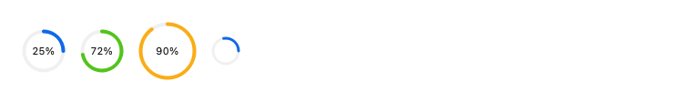

```python
from fluent_blue import CircularProgress, Stack

demo = Stack([CircularProgress(25), CircularProgress(72, variant="success"), CircularProgress(90, variant="warning", size=64),
              CircularProgress(indeterminate=True, size=32, thickness=3)], direction="horizontal", align="center", spacing=4)
```

**Properties**

| Name | Default | Description |
| --- | --- | --- |
| `value` | `0` | Current value. |
| `parent` | `None` | Parent widget. |
| `minimum` | `0` | Lower bound. |
| `maximum` | `100` | Upper bound. |
| `indeterminate` | `False` | Spin without a known value. |
| `variant` | `'primary'` | primary, success, warning, error or info. |
| `size` | `48` | Outer diameter in pixels. |
| `thickness` | `4` | Stroke width in pixels. |
| `show_label` | `True` | Show the percentage at the center. |

**Signals**

- `value_changed(float)`: The value changed.

**Best practices**

- Use in compact spaces, or as a spinner with indeterminate=True.

[AI brief for CircularProgress](../ai/components/CircularProgress.md){ .md-button }

## Skeleton

A placeholder with a soft shimmer while content loads. The timer stops while hidden.

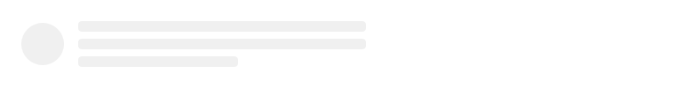

```python
from fluent_blue import Skeleton, Stack

demo = Stack([Skeleton(shape="circle", width=48), Skeleton(lines=3)], direction="horizontal", spacing=4)
```

**Properties**

| Name | Default | Description |
| --- | --- | --- |
| `parent` | `None` | Parent widget. |
| `shape` | `'text'` | text, rect or circle. |
| `lines` | `3` | Number of lines for the text shape. |
| `width` | `None` | Width for rect and circle. |
| `height` | `80` | Height for rect. |

**Best practices**

- Mirror the layout of the content that will replace it, to limit layout shift.

[AI brief for Skeleton](../ai/components/Skeleton.md){ .md-button }

## EmptyState

Explains why a view is empty and what to do next.

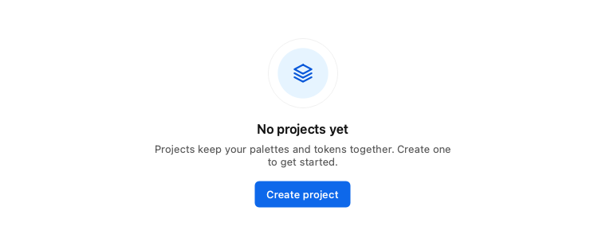

```python
from fluent_blue import EmptyState

demo = EmptyState("No projects yet", description="Projects keep your palettes and tokens together. Create one to get started.",
                  icon="layers", action_text="Create project")
```

**Properties**

| Name | Default | Description |
| --- | --- | --- |
| `title` | `'Nothing here yet'` | Headline. |
| `parent` | `None` | Parent widget. |
| `description` | `''` | Supporting text. |
| `icon` | `'inbox'` | Icon name. |
| `action_text` | `''` | Label of the optional action button. |

**Signals**

- `action_clicked()`: The action button was used.

**Best practices**

- Explain what will appear here, then offer the next step.

[AI brief for EmptyState](../ai/components/EmptyState.md){ .md-button }

## Result

The outcome of an operation.

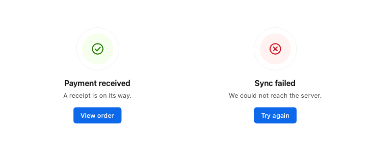

```python
from fluent_blue import Grid, Result

demo = Grid(columns=2)
demo.add(Result("success", "Payment received", description="A receipt is on its way.", action_text="View order"))
demo.add(Result("error", "Sync failed", description="We could not reach the server.", action_text="Try again"))
```

**Properties**

| Name | Default | Description |
| --- | --- | --- |
| `status` | `'success'` | success, error, warning or info. |
| `title` | `''` | Headline. |
| `parent` | `None` | Parent widget. |
| `description` | `''` | Supporting text. |
| `action_text` | `''` | Label of the optional action button. |

**Signals**

- `action_clicked()`: The action button was used.

**Best practices**

- Say what happened and what to do next. Avoid raw error codes.

[AI brief for Result](../ai/components/Result.md){ .md-button }

## Timeline

A vertical sequence of events.

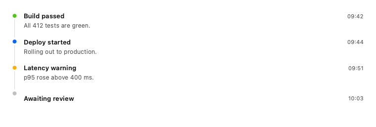

```python
from fluent_blue import Timeline

demo = Timeline([
    {"title": "Build passed", "description": "All 412 tests are green.", "time": "09:42", "variant": "success"},
    {"title": "Deploy started", "description": "Rolling out to production.", "time": "09:44"},
    {"title": "Latency warning", "description": "p95 rose above 400 ms.", "time": "09:51", "variant": "warning"},
    {"title": "Awaiting review", "time": "10:03", "variant": "neutral"},
])
```

**Properties**

| Name | Default | Description |
| --- | --- | --- |
| `items` | `None` | Dicts with title and optional description, time and variant (primary, neutral, success, warning, error or info). |
| `parent` | `None` | Parent widget. |

**Best practices**

- Order consistently, newest first for feeds and oldest first for processes.

[AI brief for Timeline](../ai/components/Timeline.md){ .md-button }

## ListItem

One row of a list.

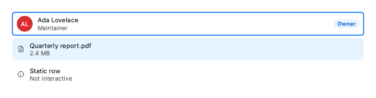

```python
from fluent_blue import Avatar, Badge, ListItem, Stack

demo = Stack([
    ListItem("Ada Lovelace", subtitle="Maintainer", leading=Avatar("Ada Lovelace"), trailing=Badge("Owner", variant="primary"), clickable=True),
    ListItem("Quarterly report.pdf", subtitle="2.4 MB", icon="file-text", clickable=True, selected=True),
    ListItem("Static row", subtitle="Not interactive", icon="info-circle"),
], spacing=1)
```

**Properties**

| Name | Default | Description |
| --- | --- | --- |
| `title` | `''` | Primary text. |
| `parent` | `None` | Parent widget. |
| `subtitle` | `''` | Secondary text. |
| `icon` | `None` | Leading icon name. |
| `leading` | `None` | Leading widget, such as an Avatar. |
| `trailing` | `None` | Trailing widget, such as a Badge. |
| `clickable` | `False` | Make the row activatable by mouse and keyboard. |
| `selected` | `False` | Initial selected state. |

**Signals**

- `clicked()`: A clickable row was activated.

**Best practices**

- Make the whole row the target, rather than a small control inside it.

[AI brief for ListItem](../ai/components/ListItem.md){ .md-button }

## BadgeOverlay

Wraps any child widget and pins a Badge to its top-right corner.

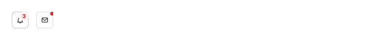

```python
from fluent_blue import BadgeOverlay, IconButton, Stack

demo = Stack([
    BadgeOverlay(IconButton("bell", variant="secondary", tooltip="Notifications"), "3"),
    BadgeOverlay(IconButton("mail", variant="secondary", tooltip="Mail"), dot=True),
], direction="horizontal", spacing=4)
```

**Properties**

| Name | Default | Description |
| --- | --- | --- |
| `target` | `required` | The target widget to wrap (e.g., an IconButton, Avatar, or Button). |
| `text` | `''` | Count or label for the badge. |
| `parent` | `None` | Parent widget. |
| `variant` | `'error'` | Status role for the badge (default error for notification dots/numbers). |
| `dot` | `False` | If True, renders as an unlabelled indicator dot. |

**Best practices**

- Show a count only when it needs attention, and hide the badge at zero.

[AI brief for BadgeOverlay](../ai/components/BadgeOverlay.md){ .md-button }

## ConsoleWidget

A high-performance rich console / terminal widget for desktop tools and logging.

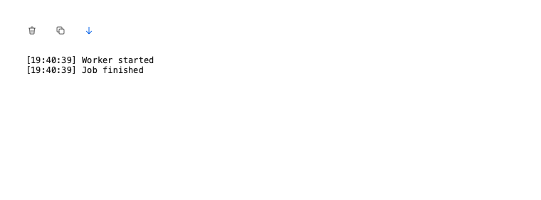

```python
from fluent_blue import ConsoleWidget

demo = ConsoleWidget()
demo.log("Worker started")
demo.log("Job finished")
demo.setMinimumHeight(180)
```

**Properties**

| Name | Default | Description |
| --- | --- | --- |
| `parent` | `None` | Parent widget. |
| `max_lines` | `2000` | Max number of log lines to retain in memory (default 2000). |
| `show_toolbar` | `True` | Whether to render the quick action toolbar on top. |
| `disabled` | `False` | Start disabled. |
| `tooltip` | `None` | Tooltip text. |

**Signals**

- `line_appended()`: 

**Best practices**

- Use for tool and bot output. Use LogViewer when people need level filters and search.

[AI brief for ConsoleWidget](../ai/components/ConsoleWidget.md){ .md-button }

## Carousel

A set of slides shown one at a time, with arrows, dots, keyboard and optional autoplay.

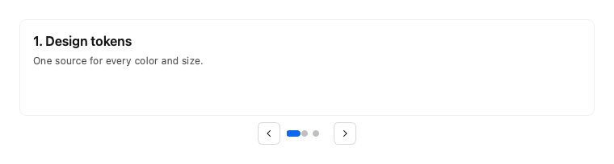

```python
from fluent_blue import Card, Carousel, Text

demo = Carousel(autoplay_ms=0)
for number, (title, note) in enumerate((("Design tokens", "One source for every color and size."), ("Runtime themes", "Switch light and dark in about 80 ms."),
                                         ("Real components", "More than a hundred, all keyboard accessible.")), start=1):
    slide = Card(title=f"{number}. {title}", subtitle=note)
    slide.setMinimumHeight(120)
    demo.add_slide(slide)
```

**Properties**

| Name | Default | Description |
| --- | --- | --- |
| `parent` | `None` | Parent widget. |
| `autoplay_ms` | `0` | Milliseconds between slides; 0 turns autoplay off. |
| `loop` | `True` | Wrap from the last slide to the first and back. |
| `show_arrows` | `True` | Show previous and next buttons. |
| `show_dots` | `True` | Show the page indicator. |

**Signals**

- `current_changed(int)`: The index of the slide now shown.

**Best practices**

- Autoplay pauses on hover, on focus and when hidden; never autoplay important content.
- Left and Right arrow keys change slides.
- Keep slides the same height to avoid the layout jumping.

[AI brief for Carousel](../ai/components/Carousel.md){ .md-button }

## Kbd

A keyboard shortcut drawn as key caps, such as Ctrl + K.

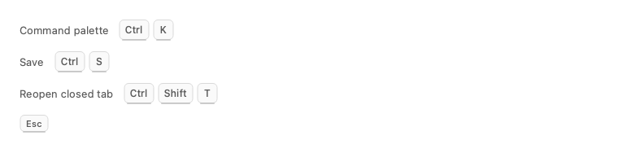

```python
from fluent_blue import Kbd, Stack, Text

def line(label, keys):
    return Stack([Text(label, color="text-secondary"), Kbd(keys)], direction="horizontal", align="center", spacing=3)

demo = Stack([line("Command palette", "Ctrl+K"), line("Save", "Ctrl+S"), line("Reopen closed tab", "Ctrl+Shift+T"), Kbd("Esc", size="small")], spacing=3)
```

**Properties**

| Name | Default | Description |
| --- | --- | --- |
| `keys` | `''` | A string such as "Ctrl+Shift+P", or a list of key names. |
| `parent` | `None` | Parent widget. |
| `size` | `'medium'` | small or medium. |

**Best practices**

- Write modifiers in the order Ctrl, Alt, Shift, then the key.
- Use the platform's names, such as Cmd on macOS.

[AI brief for Kbd](../ai/components/Kbd.md){ .md-button }
