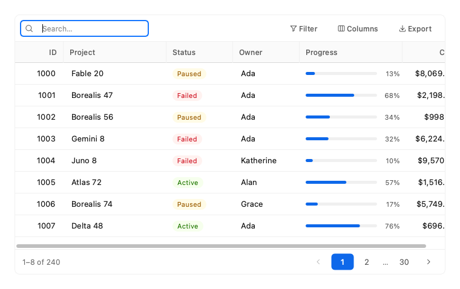
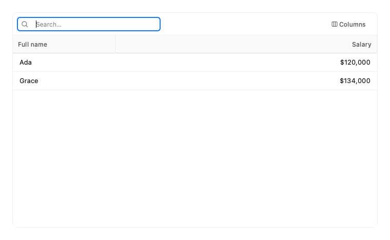

# Data Tables

A model/view table for real data: sort, filter, page, select and export.

Every example below is executed by the test suite on PyQt6 and PySide6, in each built-in theme.

## DataTable

A table with sorting, filtering, paging, selection, column control and export.



```python
import random

from fluent_blue import Column, DataTable, badge_renderer, progress_renderer

rng = random.Random(7)
names = ["Atlas", "Borealis", "Cirrus", "Delta", "Echo", "Fable", "Gemini", "Helix", "Ion", "Juno"]
rows = [{
    "id": 1000 + i,
    "project": f"{rng.choice(names)} {rng.randint(1, 99)}",
    "status": rng.choice(["Active", "Paused", "Failed"]),
    "owner": rng.choice(["Ada", "Grace", "Alan", "Katherine"]),
    "progress": rng.randint(4, 100),
    "cost": round(rng.uniform(120, 9800), 2),
} for i in range(240)]

demo = DataTable([
    Column("id", "ID", width=80, align="right"),
    Column("project", width=170),
    Column("status", width=110, filterable=True,
           renderer=badge_renderer({"Active": "success", "Paused": "warning", "Failed": "error"})),
    Column("owner", width=110, filterable=True),
    Column("progress", width=170, renderer=progress_renderer()),
    Column("cost", align="right", formatter=lambda v: f"${v:,.2f}"),
], rows, page_size=8, selection="multi")
demo.setMinimumHeight(430)
```

**Properties**

| Name | Default | Description |
| --- | --- | --- |
| `columns` | `None` | Column objects or plain keys. |
| `rows` | `None` | A list of dicts. |
| `parent` | `None` | Parent widget. |
| `page_size` | `25` | Rows per page; None disables paging and shows all rows. |
| `selection` | `'single'` | none, single or multi. Selection persists across pages. |
| `searchable` | `True` | Show the search field. |
| `column_menu` | `True` | Show the column visibility button. |
| `exportable` | `True` | Show the export button. |
| `striped` | `False` | Alternate row backgrounds. |
| `empty_title` | `'No results'` | Headline of the empty state. |
| `empty_description` | `'Try changing the search or filters.'` | Text of the empty state. |
| `row_height` | `36` | Row height in pixels. |

**Signals**

- `selection_changed(list)`: The selected row dicts.
- `row_activated(dict)`: A row was double-clicked or Enter was pressed.
- `page_changed(int)`: The current page changed.
- `context_menu_requested(list, object)`: Rows under the cursor and the global position.

**Best practices**

- Right-align numbers so that magnitudes line up.
- Use page_size=None only with a small row count, or keep a filter visible.

[AI brief for DataTable](../ai/components/DataTable.md){ .md-button }

## Column

Describes one table column.



```python
from fluent_blue import Column, DataTable

demo = DataTable([
    Column("name", "Full name", width=200),
    Column("salary", align="right", formatter=lambda v: f"${v:,}"),
    Column("note", sortable=False, visible=False),
], [{"name": "Ada", "salary": 120000, "note": "hidden"}, {"name": "Grace", "salary": 134000, "note": "hidden"}],
    page_size=None, exportable=False)
demo.setMinimumHeight(190)
```

**Properties**

| Name | Default | Description |
| --- | --- | --- |
| `key` | `required` | Key of the value in each row dict. |
| `title` | `''` | Header text; defaults to the key in title case. |
| `width` | `None` | Initial width in pixels; None leaves it to the table. |
| `sortable` | `True` | Allow sorting by this column. |
| `filterable` | `False` | Offer this column's values in the filter menu. |
| `visible` | `True` | Initially visible. |
| `align` | `'left'` | left, center or right. |
| `formatter` | `None` | callable(value) -> str for the display text. |
| `renderer` | `None` | callable(painter, rect, value, row) for custom painting. |
| `sort_key` | `None` | callable(value) to override the sort value. |

**Best practices**

- Formatters change only the display, so sorting still uses the raw value.

[AI brief for Column](../ai/components/Column.md){ .md-button }
