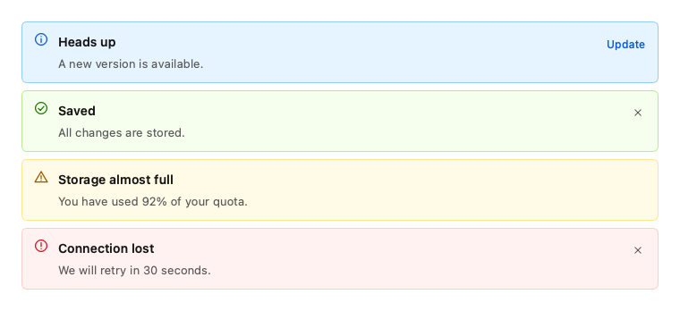
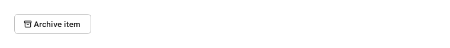
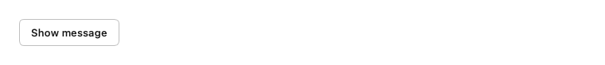
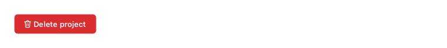
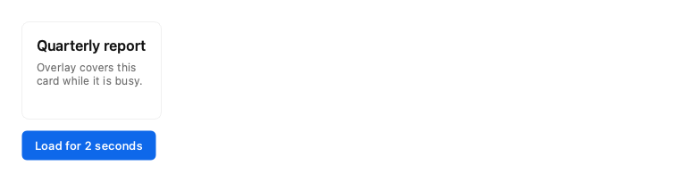
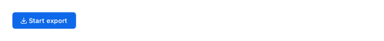

# Feedback

Tell people what happened, and what is happening now.

Every example below is executed by the test suite on PyQt6 and PySide6, in each built-in theme.

## Alert

An inline message in the page flow.



```python
from fluent_blue import Alert, Stack

demo = Stack([
    Alert("Heads up", "A new version is available.", variant="info", action_text="Update"),
    Alert("Saved", "All changes are stored.", variant="success", closable=True),
    Alert("Storage almost full", "You have used 92% of your quota.", variant="warning"),
    Alert("Connection lost", "We will retry in 30 seconds.", variant="error", closable=True),
])
```

**Properties**

| Name | Default | Description |
| --- | --- | --- |
| `title` | `''` | Bold first line. |
| `message` | `''` | Body text. |
| `parent` | `None` | Parent widget. |
| `variant` | `'info'` | info, success, warning or error. |
| `closable` | `False` | Show a dismiss button. |
| `action_text` | `''` | Label of an optional action. |
| `dense` | `False` | Use tighter spacing and smaller text. |

**Signals**

- `closed()`: The alert was dismissed.
- `action_clicked()`: The action was used.

**Best practices**

- Use for persistent, in-context messages. Use Toast for passing confirmation.

[AI brief for Alert](../ai/components/Alert.md){ .md-button }

## Toast

A brief, auto-dismissing message in the window's top right corner.


```python
from fluent_blue import Button, Stack, Toast

def button(text, variant):
    b = Button(text)
    b.clicked.connect(lambda: Toast.show(f"{text} toast message", parent=b, variant=variant))
    return b

demo = Stack([button("Info", "info"), button("Success", "success"), button("Warning", "warning"), button("Error", "error")],
             direction="horizontal")
```

**Properties**

| Name | Default | Description |
| --- | --- | --- |
| `message` | `required` | Text. |
| `parent` | `None` | Any widget of the target window; defaults to the active window. |
| `variant` | `'info'` | info, success, warning or error. |
| `duration` | `3500` | Milliseconds before dismissal, paused on hover. 0 keeps it open. |

**Best practices**

- Keep it to one sentence. People may not see it before it goes.
- Do not put errors requiring action here; use Alert or a dialog.

[AI brief for Toast](../ai/components/Toast.md){ .md-button }

## Notification

A richer message with a title and an action, which stays until dismissed by default.


```python
from fluent_blue import Button, Notification

demo = Button("Notify", icon="bell", variant="primary")
demo.clicked.connect(lambda: Notification.show("Export finished", "Your report is ready to download.", parent=demo,
                                               variant="success", action_text="Open"))
```

**Properties**

| Name | Default | Description |
| --- | --- | --- |
| `title` | `required` | Headline. |
| `message` | `''` | Body text. |
| `parent` | `None` | Any widget of the target window; defaults to the active window. |
| `variant` | `'info'` | info, success, warning or error. |
| `duration` | `0` | Milliseconds before dismissal; 0 keeps it until dismissed. |
| `action_text` | `''` | Action label. |
| `on_action` | `None` | Callable to run when the action is used. |

**Best practices**

- Use for events that deserve attention until acknowledged.

[AI brief for Notification](../ai/components/Notification.md){ .md-button }

## Snackbar

A single-line message at the bottom center, often offering an undo.



```python
from fluent_blue import Button, Snackbar

demo = Button("Archive item", icon="archive")
demo.clicked.connect(lambda: Snackbar.show("Item archived", parent=demo, action_text="Undo"))
```

**Properties**

| Name | Default | Description |
| --- | --- | --- |
| `message` | `required` | Text. |
| `parent` | `None` | Any widget of the target window; defaults to the active window. |
| `action_text` | `''` | Action label, such as "Undo". |
| `on_action` | `None` | Callable to run when the action is used. |
| `duration` | `4000` | Milliseconds before dismissal. |

**Best practices**

- Prefer an undo over a confirmation dialog for reversible actions.

[AI brief for Snackbar](../ai/components/Snackbar.md){ .md-button }

## MessageDialog

A modal with a status icon, a message and buttons.



```python
from fluent_blue import Button, MessageDialog

demo = Button("Show message")

def show():
    dialog = MessageDialog(demo, title="Update installed", message="Restart the app to finish.", variant="success",
                           buttons=("Later", "Restart"))
    dialog.finished.connect(dialog.deleteLater)
    dialog.open()

demo.clicked.connect(show)
```

**Properties**

| Name | Default | Description |
| --- | --- | --- |
| `parent` | `None` | Owner window. |
| `title` | `''` | Header title. |
| `message` | `''` | Body text. |
| `variant` | `'info'` | info, success, warning or error. |
| `buttons` | `('OK',)` | Labels from left to right; the last one is primary. |
| `content` | `None` | Text or a widget for the body. |
| `width` | `460` | Panel width in pixels. |
| `closable` | `True` | Allow closing with the header button and Escape. |

**Signals**

- `button_clicked(str)`: The label of the chosen button.
- `closed()`: The dialog was hidden, regardless of outcome. Inherits accepted and rejected from QDialog.

**Best practices**

- Interrupt only for information people must see now.

[AI brief for MessageDialog](../ai/components/MessageDialog.md){ .md-button }

## ConfirmDialog

Ask the user to confirm an action.



```python
from fluent_blue import ConfirmDialog, DangerButton, Toast

demo = DangerButton("Delete project", icon="trash")

def ask():
    dialog = ConfirmDialog(demo, title="Delete this project?", message="All its data is removed. This cannot be undone.",
                           confirm_text="Delete project", danger=True)
    dialog.confirmed.connect(lambda: Toast.show("Project deleted", parent=demo, variant="success"))
    dialog.finished.connect(dialog.deleteLater)
    dialog.open()

demo.clicked.connect(ask)
```

**Properties**

| Name | Default | Description |
| --- | --- | --- |
| `parent` | `None` | Owner window. |
| `title` | `'Are you sure?'` | Header title. |
| `message` | `''` | Body text; state the consequence. |
| `confirm_text` | `'Confirm'` | Label of the confirm button; use a verb. |
| `cancel_text` | `'Cancel'` | Label of the cancel button. |
| `danger` | `False` | Style the confirm button as destructive. |
| `variant` | `'info'` | info, success, warning or error. |
| `buttons` | `('OK',)` | Labels from left to right; the last one is primary. |
| `content` | `None` | Text or a widget for the body. |
| `width` | `460` | Panel width in pixels. |
| `closable` | `True` | Allow closing with the header button and Escape. |

**Signals**

- `confirmed()`: The action was confirmed.
- `cancelled()`: The dialog closed in any other way.
- `button_clicked(str)`: The label of the chosen button.
- `closed()`: The dialog was hidden, regardless of outcome. Inherits accepted and rejected from QDialog.

**Best practices**

- State the consequence, and label the button with the action, not “OK”.

[AI brief for ConfirmDialog](../ai/components/ConfirmDialog.md){ .md-button }

## LoadingOverlay

Blocks a widget and shows a spinner while it is busy.



```python
from fluent_blue import Button, Card, LoadingOverlay, Stack, Text
from fluent_blue.compatibility.qt import QTimer

card = Card(title="Quarterly report", subtitle="Overlay covers this card while it is busy.")
card.setMinimumHeight(110)
overlay = LoadingOverlay(card, message="Refreshing…")
start = Button("Load for 2 seconds", variant="primary")

def run():
    overlay.start()
    QTimer.singleShot(2000, overlay.stop)

start.clicked.connect(run)
demo = Stack([card, start], align="start", spacing=3)
```

**Properties**

| Name | Default | Description |
| --- | --- | --- |
| `target` | `required` | The widget to cover. |
| `message` | `''` | Optional text below the spinner. |

**Best practices**

- Cover only the region that is busy, not the whole window.

[AI brief for LoadingOverlay](../ai/components/LoadingOverlay.md){ .md-button }

## ProgressDialog

A modal that reports the progress of a long operation.



```python
from fluent_blue import Button, ProgressDialog
from fluent_blue.compatibility.qt import QTimer

demo = Button("Start export", icon="download", variant="primary")

def run():
    dialog = ProgressDialog(demo, title="Exporting", message="Writing 1,204 rows…")
    timer = QTimer(dialog)
    timer.setInterval(40)
    timer.timeout.connect(lambda: dialog.set_value(dialog.value() + 1))
    dialog.finished.connect(lambda _r: timer.stop())
    dialog.finished.connect(dialog.deleteLater)
    timer.start()
    dialog.open()

demo.clicked.connect(run)
```

**Properties**

| Name | Default | Description |
| --- | --- | --- |
| `parent` | `None` | Owner window. |
| `title` | `'Working…'` | Header title. |
| `message` | `''` | Status text. |
| `maximum` | `100` | Value at completion. |
| `cancellable` | `True` | Show a cancel button. |
| `auto_close` | `True` | Close automatically at completion. |
| `content` | `None` | Text or a widget for the body. |
| `width` | `460` | Panel width in pixels. |
| `closable` | `True` | Allow closing with the header button and Escape. |

**Signals**

- `canceled()`: The user asked to cancel.
- `closed()`: The dialog was hidden, regardless of outcome. Inherits accepted and rejected from QDialog.

**Best practices**

- Offer Cancel whenever the work can stop safely.

[AI brief for ProgressDialog](../ai/components/ProgressDialog.md){ .md-button }
