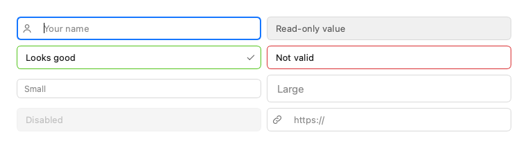
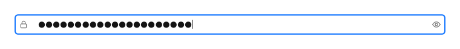
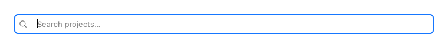
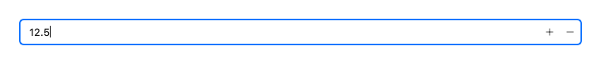
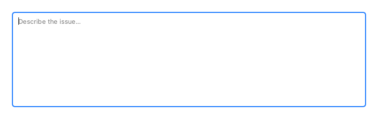
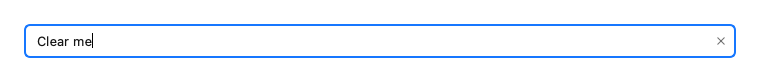
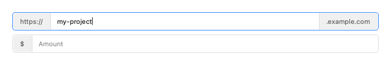
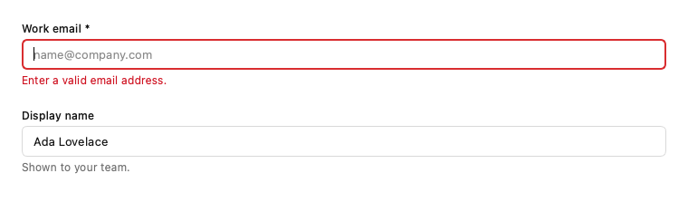
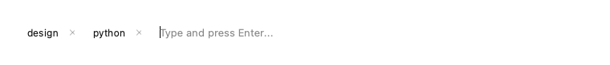

# Inputs

Collect text and numbers, with validation built in.

Every example below is executed by the test suite on PyQt6 and PySide6, in each built-in theme.

## Input

A text input with icons, a clear button and validation state.



```python
from fluent_blue import Grid, Input

demo = Grid(columns=2, gap=2)
demo.add(Input(placeholder="Your name", prefix_icon="user"))
demo.add(Input("Read-only value", read_only=True))
demo.add(Input("Looks good", validation="success", suffix_icon="check"))
demo.add(Input("Not valid", validation="error"))
demo.add(Input(placeholder="Small", size="small"))
demo.add(Input(placeholder="Large", size="large"))
demo.add(Input("Disabled", disabled=True))
demo.add(Input(placeholder="https://", prefix_icon="link", clearable=True))
```

**Properties**

| Name | Default | Description |
| --- | --- | --- |
| `text` | `''` | Initial text. |
| `parent` | `None` | Parent widget. |
| `placeholder` | `''` | Placeholder text. |
| `size` | `'medium'` | small, medium or large. |
| `prefix_icon` | `None` | Icon name at the start. |
| `suffix_icon` | `None` | Icon name at the end. |
| `clearable` | `False` | Show a clear button while the field has text. |
| `validation` | `'none'` | none, error, warning or success. |
| `read_only` | `False` | Selectable but not editable. |
| `disabled` | `False` | Start disabled. |
| `tooltip` | `None` | Tooltip text. |
| `accessible_name` | `None` | Name for assistive technology; defaults to the placeholder. |

**Signals**

- `cleared()`: The clear button was used. Inherits textChanged, editingFinished and returnPressed from QLineEdit.
- Inherits textChanged, editingFinished and returnPressed from QLineEdit.

**Best practices**

- Wrap in FormField to add a label and messages.
- Placeholders are hints; they never replace a label.

[AI brief for Input](../ai/components/Input.md){ .md-button }

## PasswordInput

A masked input with a visibility toggle.



```python
from fluent_blue import PasswordInput

demo = PasswordInput("correct horse battery")
```

**Properties**

| Name | Default | Description |
| --- | --- | --- |
| `text` | `''` | Initial text. |
| `parent` | `None` | Parent widget. |
| `placeholder` | `'Password'` | Placeholder text. |
| `size` | `'medium'` | small, medium or large. |
| `prefix_icon` | `None` | Icon name at the start. |
| `suffix_icon` | `None` | Icon name at the end. |
| `clearable` | `False` | Show a clear button while the field has text. |
| `validation` | `'none'` | none, error, warning or success. |
| `read_only` | `False` | Selectable but not editable. |
| `disabled` | `False` | Start disabled. |
| `tooltip` | `None` | Tooltip text. |
| `accessible_name` | `None` | Name for assistive technology; defaults to the placeholder. |

**Signals**

- `visibility_changed(bool)`: True when the password is shown.
- `cleared()`: The clear button was used. Inherits textChanged, editingFinished and returnPressed from QLineEdit.

**Best practices**

- Let people reveal what they typed; it reduces errors.
- Never pre-fill a real password.

[AI brief for PasswordInput](../ai/components/PasswordInput.md){ .md-button }

## SearchInput

A clearable search field that debounces typing.



```python
from fluent_blue import SearchInput

demo = SearchInput(placeholder="Search projects…", debounce_ms=250)
```

**Properties**

| Name | Default | Description |
| --- | --- | --- |
| `text` | `''` | Initial text. |
| `parent` | `None` | Parent widget. |
| `placeholder` | `'Search…'` | Placeholder text. |
| `debounce_ms` | `200` | Quiet time before search_changed fires; 0 fires on every keystroke. |
| `size` | `'medium'` | small, medium or large. |
| `prefix_icon` | `None` | Icon name at the start. |
| `suffix_icon` | `None` | Icon name at the end. |
| `clearable` | `False` | Show a clear button while the field has text. |
| `validation` | `'none'` | none, error, warning or success. |
| `read_only` | `False` | Selectable but not editable. |
| `disabled` | `False` | Start disabled. |
| `tooltip` | `None` | Tooltip text. |
| `accessible_name` | `None` | Name for assistive technology; defaults to the placeholder. |

**Signals**

- `search_changed(str)`: The settled query.
- `cleared()`: The clear button was used. Inherits textChanged, editingFinished and returnPressed from QLineEdit.

**Best practices**

- Connect to search_changed rather than textChanged, to avoid a query on each keystroke.

[AI brief for SearchInput](../ai/components/SearchInput.md){ .md-button }

## NumberInput

A numeric input with bounds, steppers and arrow key support.



```python
from fluent_blue import NumberInput

demo = NumberInput(12.5, minimum=0, maximum=100, step=0.5, decimals=1)
```

**Properties**

| Name | Default | Description |
| --- | --- | --- |
| `value` | `0` | Initial value. |
| `parent` | `None` | Parent widget. |
| `minimum` | `-1000000000000.0` | Lower bound. |
| `maximum` | `1000000000000.0` | Upper bound. |
| `step` | `1` | Amount added by the steppers and arrow keys. |
| `decimals` | `0` | Digits after the decimal point. |
| `text` | `''` | Initial text. |
| `placeholder` | `''` | Placeholder text. |
| `size` | `'medium'` | small, medium or large. |
| `prefix_icon` | `None` | Icon name at the start. |
| `suffix_icon` | `None` | Icon name at the end. |
| `clearable` | `False` | Show a clear button while the field has text. |
| `validation` | `'none'` | none, error, warning or success. |
| `read_only` | `False` | Selectable but not editable. |
| `disabled` | `False` | Start disabled. |
| `tooltip` | `None` | Tooltip text. |
| `accessible_name` | `None` | Name for assistive technology; defaults to the placeholder. |

**Signals**

- `value_changed(float)`: The committed numeric value changed.
- `cleared()`: The clear button was used. Inherits textChanged, editingFinished and returnPressed from QLineEdit.

**Best practices**

- Set realistic bounds; the value is clamped on commit.
- Up and Down arrow keys step the value.

[AI brief for NumberInput](../ai/components/NumberInput.md){ .md-button }

## TextArea

A multi-line plain text input.



```python
from fluent_blue import TextArea

demo = TextArea(placeholder="Describe the issue…", max_length=280, rows=3)
```

**Properties**

| Name | Default | Description |
| --- | --- | --- |
| `text` | `''` | Initial text. |
| `parent` | `None` | Parent widget. |
| `placeholder` | `''` | Placeholder text. |
| `max_length` | `None` | Hard limit on length in characters; None for no limit. |
| `rows` | `4` | Approximate visible rows, used for the minimum height. |
| `validation` | `'none'` | none, error, warning or success. |
| `read_only` | `False` | Selectable but not editable. |
| `disabled` | `False` | Start disabled. |
| `tooltip` | `None` | Tooltip text. |

**Signals**

- `text_changed(str)`: The new content.

**Best practices**

- Size it for the expected answer length; the box height is a hint to the user.

[AI brief for TextArea](../ai/components/TextArea.md){ .md-button }

## ClearableInput

An Input with the clear button on by default.



```python
from fluent_blue import ClearableInput

demo = ClearableInput("Clear me", placeholder="Type something")
```

**Properties**

| Name | Default | Description |
| --- | --- | --- |
| `text` | `''` | Initial text. |
| `parent` | `None` | Parent widget. |
| `placeholder` | `''` | Placeholder text. |
| `size` | `'medium'` | small, medium or large. |
| `prefix_icon` | `None` | Icon name at the start. |
| `suffix_icon` | `None` | Icon name at the end. |
| `clearable` | `False` | Show a clear button while the field has text. |
| `validation` | `'none'` | none, error, warning or success. |
| `read_only` | `False` | Selectable but not editable. |
| `disabled` | `False` | Start disabled. |
| `tooltip` | `None` | Tooltip text. |
| `accessible_name` | `None` | Name for assistive technology; defaults to the placeholder. |

**Signals**

- `cleared()`: The clear button was used. Inherits textChanged, editingFinished and returnPressed from QLineEdit.

**Best practices**

- Useful for filters and any value people often replace entirely.

[AI brief for ClearableInput](../ai/components/ClearableInput.md){ .md-button }

## InputGroup

Joins an input with text or widget addons inside a single border.



```python
from fluent_blue import Button, Input, InputGroup, Stack

demo = Stack([
    InputGroup(Input("my-project"), prefix="https://", suffix=".example.com"),
    InputGroup(Input(placeholder="Amount"), prefix="$"),
], spacing=2)
```

**Properties**

| Name | Default | Description |
| --- | --- | --- |
| `control` | `None` | The central input. |
| `parent` | `None` | Parent widget. |
| `prefix` | `None` | Leading text or widget. |
| `suffix` | `None` | Trailing text or widget. |

**Best practices**

- Use addons for units and fixed affixes, so they are not typed by mistake.

[AI brief for InputGroup](../ai/components/InputGroup.md){ .md-button }

## FormField

Label, control, helper text and error message as one unit.



```python
from fluent_blue import FormField, Input, Stack

def check_email(value):
    return None if "@" in value else "Enter a valid email address."

email = FormField("Work email", Input(placeholder="name@company.com"), required=True,
                  helper="Used for sign-in only.", validator=check_email)
email.validate()
name = FormField("Display name", Input("Ada Lovelace"), helper="Shown to your team.")
demo = Stack([email, name], spacing=4)
```

**Properties**

| Name | Default | Description |
| --- | --- | --- |
| `label` | `''` | Field label, linked to the control as its buddy for keyboard access. |
| `control` | `None` | The input widget. |
| `parent` | `None` | Parent widget. |
| `helper` | `''` | Helper text shown when there is no error. |
| `required` | `False` | Append a required marker to the label. |
| `validator` | `None` | Optional callable(value) -> str \| None returning an error message. It runs on validate() and when an input finishes editing. |

**Signals**

- `validated(bool)`: Emitted after validation with the outcome.

**Best practices**

- Validate when the field loses focus, not on each keystroke.
- Say how to fix the problem, not just that one exists.

[AI brief for FormField](../ai/components/FormField.md){ .md-button }

## OtpInput

A multi-slot numeric OTP / 2FA code entry widget with auto-focus and paste support.


```python
from fluent_blue import OtpInput

demo = OtpInput()
```

**Properties**

| Name | Default | Description |
| --- | --- | --- |
| `parent` | `None` | Parent widget. |
| `length` | `6` | Number of digit slots (default 6). |
| `size` | `'medium'` | small, medium, or large. |
| `mask` | `False` | If True, masks characters for PIN codes. |
| `validation` | `'none'` | none, error, warning, or success. |
| `disabled` | `False` | Start disabled. |
| `tooltip` | `None` | Tooltip text. |

**Signals**

- `code_changed(str)`: Emitted whenever digits change.
- `completed(str)`: Emitted when all digits are filled.

**Best practices**

- Paste is supported, so people can drop in a whole code.
- Connect to completed, which fires once every digit is filled.

[AI brief for OtpInput](../ai/components/OtpInput.md){ .md-button }

## TagInput

An input field that converts typed text into removable tags on Enter or comma.



```python
from fluent_blue import TagInput

demo = TagInput()
demo.add_tag("design")
demo.add_tag("python")
```

**Properties**

| Name | Default | Description |
| --- | --- | --- |
| `parent` | `None` | Parent widget. |
| `tags` | `None` | Initial list of string tags. |
| `placeholder` | `'Type and press Enter...'` | Placeholder text when empty. |
| `max_tags` | `None` | Maximum allowable tags. |
| `disabled` | `False` | Start disabled. |
| `tooltip` | `None` | Tooltip text. |

**Signals**

- `tags_changed(list)`: List of all tags after add/remove.
- `tag_added(str)`: The added tag.
- `tag_removed(str)`: The removed tag.

**Best practices**

- Use for free-form labels; use MultiSelect when the options are a fixed list.

[AI brief for TagInput](../ai/components/TagInput.md){ .md-button }
