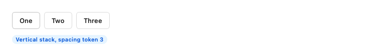
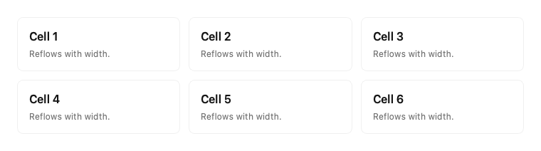
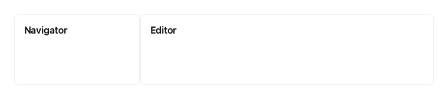
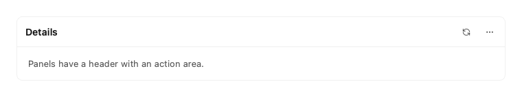
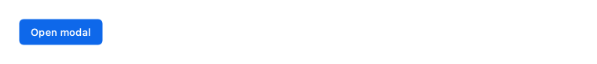
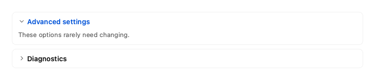
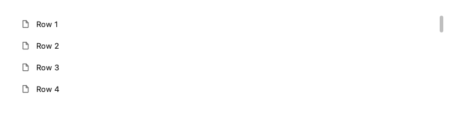
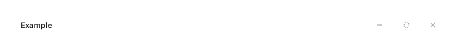
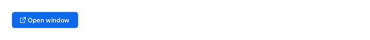
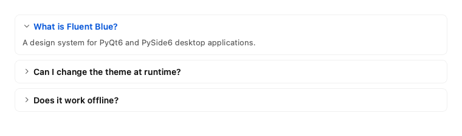

# Layout

Structure pages with token-based spacing, and overlay panels.

Every example below is executed by the test suite on PyQt6 and PySide6, in each built-in theme.

## Container

Centers content and limits its width, keeping long lines readable on wide screens.


```python
from fluent_blue import Card, Container

demo = Container(max_width=420, padding=2)
demo.add(Card(title="Limited width", subtitle="Content stops growing at 420 px, which keeps line length readable."))
```

**Properties**

| Name | Default | Description |
| --- | --- | --- |
| `parent` | `None` | Parent widget. |
| `max_width` | `1120` | Maximum content width in pixels. |
| `padding` | `6` | Spacing token step used around the content. |

**Best practices**

- Wrap page content in it so that very wide monitors stay comfortable.

[AI brief for Container](../ai/components/Container.md){ .md-button }

## Stack

Arranges children in a row or column with token spacing.



```python
from fluent_blue import Badge, Button, Stack

row = Stack([Button("One"), Button("Two"), Button("Three")], direction="horizontal", spacing=2)
demo = Stack([row, Badge("Vertical stack, spacing token 3", variant="primary")], spacing=3, align="start")
```

**Properties**

| Name | Default | Description |
| --- | --- | --- |
| `children` | `None` | Initial widgets. |
| `parent` | `None` | Parent widget. |
| `direction` | `'vertical'` | vertical or horizontal. |
| `spacing` | `2` | Spacing token step (2 means 8 px). |
| `padding` | `0` | Spacing token step around the content. |
| `align` | `'stretch'` | start, center, end or stretch on the cross axis. |

**Best practices**

- Spacing takes token steps, which keeps the 4 px rhythm without magic numbers.

[AI brief for Stack](../ai/components/Stack.md){ .md-button }

## Grid

A grid with a fixed column count, or responsive columns from a minimum width.



```python
from fluent_blue import Card, Grid

demo = Grid(min_column_width=180)
for number in range(1, 7):
    demo.add(Card(title=f"Cell {number}", subtitle="Reflows with width."))
```

**Properties**

| Name | Default | Description |
| --- | --- | --- |
| `parent` | `None` | Parent widget. |
| `columns` | `3` | Fixed column count. Ignored if min_column_width is set. |
| `min_column_width` | `None` | Reflow to fit as many columns of this width as possible. |
| `gap` | `3` | Spacing token step between cells. |

**Best practices**

- Set min_column_width for responsive layouts, or columns for a fixed one.

[AI brief for Grid](../ai/components/Grid.md){ .md-button }

## Splitter

A resizable split view.



```python
from fluent_blue import Card, Splitter

demo = Splitter([Card(title="Navigator"), Card(title="Editor")], sizes=[180, 420])
demo.setFixedHeight(120)
```

**Properties**

| Name | Default | Description |
| --- | --- | --- |
| `widgets` | `None` | Initial panes. |
| `parent` | `None` | Parent widget. |
| `orientation` | `'horizontal'` | horizontal or vertical. |
| `sizes` | `None` | Initial pane sizes in pixels. |
| `collapsible` | `False` | Allow panes to be collapsed by dragging. |

**Signals**

- Inherits splitterMoved(int, int) from QSplitter.

**Best practices**

- Set sensible minimum sizes on panes so that they cannot be crushed.

[AI brief for Splitter](../ai/components/Splitter.md){ .md-button }

## Panel

A titled section with a header action area.



```python
from fluent_blue import IconButton, Panel, Text

demo = Panel("Details", actions=[IconButton("refresh", size="small", tooltip="Refresh"), IconButton("more-horizontal", size="small", tooltip="More")])
demo.add(Text("Panels have a header with an action area.", color="text-secondary"))
```

**Properties**

| Name | Default | Description |
| --- | --- | --- |
| `title` | `''` | Header title. |
| `parent` | `None` | Parent widget. |
| `actions` | `None` | Widgets placed at the right of the header. |
| `padding` | `4` | Spacing token step around the body. |

**Best practices**

- Use for tool regions in app layouts. Use Card for self-contained content.

[AI brief for Panel](../ai/components/Panel.md){ .md-button }

## Drawer

A panel that slides in from the edge of a window.


```python
from fluent_blue import Button, Drawer, FormField, Input, Stack

demo = Stack([Button("Open drawer", icon="sidebar", variant="primary")], align="start")
trigger = demo.findChildren(Button)[0]

def open_drawer():
    drawer = Drawer(demo, title="Edit profile")
    drawer.add(FormField("Name", Input("Ada Lovelace")))
    drawer.add(Button("Save", variant="primary"))
    drawer.body.addStretch(1)
    drawer.closed.connect(drawer.deleteLater)
    drawer.open_drawer()

trigger.clicked.connect(open_drawer)
```

**Properties**

| Name | Default | Description |
| --- | --- | --- |
| `parent` | `required` | Any widget in the target window. |
| `title` | `''` | Header title. |
| `placement` | `'right'` | left or right. |
| `width` | `360` | Panel width in pixels. |
| `dismissible` | `True` | Close on Escape and on clicks on the scrim. |

**Signals**

- `opened()`: The drawer started opening.
- `closed()`: The drawer finished closing.

**Best practices**

- Use when people need to keep the page in view while they work.

[AI brief for Drawer](../ai/components/Drawer.md){ .md-button }

## Modal

A themed modal dialog over a dimmed parent window.



```python
from fluent_blue import Button, FormField, Input, Modal

demo = Button("Open modal", variant="primary")

def show():
    modal = Modal(demo, title="Rename project")
    modal.body.addWidget(FormField("Name", Input("Fluent Blue")))
    modal.add_action(Button("Cancel")).clicked.connect(modal.reject)
    modal.add_action(Button("Rename", variant="primary")).clicked.connect(modal.accept)
    modal.finished.connect(modal.deleteLater)
    modal.open()

demo.clicked.connect(show)
```

**Properties**

| Name | Default | Description |
| --- | --- | --- |
| `parent` | `None` | Owner window. |
| `title` | `''` | Header title. |
| `content` | `None` | Text or a widget for the body. |
| `width` | `460` | Panel width in pixels. |
| `closable` | `True` | Allow closing with the header button and Escape. |

**Signals**

- `closed()`: The dialog was hidden, regardless of outcome. Inherits accepted and rejected from QDialog.
- Inherits accepted and rejected from QDialog.

**Best practices**

- Modals stop everything, so keep them short and focused on one decision.

[AI brief for Modal](../ai/components/Modal.md){ .md-button }

## CollapsiblePanel

A panel whose content expands and collapses.



```python
from fluent_blue import CollapsiblePanel, Stack, Text

one = CollapsiblePanel("Advanced settings")
one.add(Text("These options rarely need changing.", color="text-secondary"))
two = CollapsiblePanel("Diagnostics", expanded=False)
two.add(Text("Hidden until expanded.", color="text-secondary"))
demo = Stack([one, two])
```

**Properties**

| Name | Default | Description |
| --- | --- | --- |
| `title` | `''` | Header text. |
| `parent` | `None` | Parent widget. |
| `expanded` | `True` | Initial state. |
| `padding` | `3` | Spacing token step around the body. |

**Signals**

- `toggled(bool)`: True when expanded.

**Best practices**

- Hide secondary options, but never required fields.

[AI brief for CollapsiblePanel](../ai/components/CollapsiblePanel.md){ .md-button }

## ScrollArea

A frameless scroll area with themed scrollbars and a resizable content widget.



```python
from fluent_blue import ListItem, ScrollArea, Stack

demo = ScrollArea(Stack([ListItem(f"Row {n}", icon="file") for n in range(1, 21)], spacing=1))
demo.setFixedHeight(150)
```

**Properties**

| Name | Default | Description |
| --- | --- | --- |
| `widget` | `None` | Content widget. |
| `parent` | `None` | Parent widget. |
| `horizontal` | `False` | Allow horizontal scrolling. |

**Best practices**

- Avoid nested vertical scrolling; it traps the mouse wheel.

[AI brief for ScrollArea](../ai/components/ScrollArea.md){ .md-button }

## TitleBar

Custom titlebar with native-like window management buttons, draggable area, and branding.



```python
from fluent_blue import FluentWindow, TitleBar

window = FluentWindow(title="Example")
demo = window.findChild(TitleBar)
demo.setParent(None)
```

**Properties**

| Name | Default | Description |
| --- | --- | --- |
| `window` | `required` | The window this bar moves and controls. |
| `parent` | `None` | Parent widget. |
| `title` | `''` | Title text. |
| `icon_name` | `None` | Icon name shown before the title. |
| `show_minimize` | `True` | Show the minimize button. |
| `show_maximize` | `True` | Show the maximize button. |
| `show_close` | `True` | Show the close button. |

**Best practices**

- Usually created for you by FluentWindow.

[AI brief for TitleBar](../ai/components/TitleBar.md){ .md-button }

## FluentWindow

A frameless base window styled with Fluent Blue design language.



```python
from fluent_blue import Button, FluentWindow

launch = Button("Open window", icon="external-link", variant="primary")
window = FluentWindow(title="Fluent Blue Application")
window.set_central_widget(Button("Central content"))
window.resize(480, 280)
launch.clicked.connect(window.show)
demo = launch
```

**Properties**

| Name | Default | Description |
| --- | --- | --- |
| `parent` | `None` | Parent widget. |
| `title` | `'Fluent Blue Application'` | Window title. |
| `icon_name` | `None` | Optional icon name from Fluent Blue icon system. |

**Best practices**

- Keep the keyboard shortcuts for closing the window working when you customize it.

[AI brief for FluentWindow](../ai/components/FluentWindow.md){ .md-button }

## Accordion

A vertical stack of collapsible sections, optionally allowing only one open at a time.



```python
from fluent_blue import Accordion, Text

demo = Accordion(exclusive=True)
demo.add_item("What is Fluent Blue?", "A design system for PyQt6 and PySide6 desktop applications.", expanded=True)
demo.add_item("Can I change the theme at runtime?", "Yes. ThemeManager.set_theme restyles every open window.")
demo.add_item("Does it work offline?", Text("It has no network code at all.", color="text-secondary"))
```

**Properties**

| Name | Default | Description |
| --- | --- | --- |
| `parent` | `None` | Parent widget. |
| `exclusive` | `False` | Opening a section closes the others. |
| `spacing` | `2` | Spacing token step between sections. |

**Signals**

- `expanded_changed(int, bool)`: The index of a section and whether it is now expanded.

**Best practices**

- Use exclusive=True for FAQs so that one answer is open at a time.
- Put long help text here, not essential form fields.

[AI brief for Accordion](../ai/components/Accordion.md){ .md-button }
