# Navigation

Move around an application and find commands quickly.

Every example below is executed by the test suite on PyQt6 and PySide6, in each built-in theme.

## Sidebar

A vertical, sectioned, collapsible navigation rail.

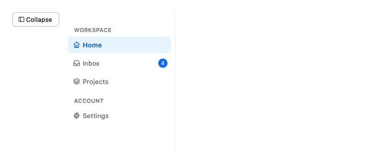

```python
from fluent_blue import Button, Sidebar, Stack

sidebar = Sidebar(width=220)
sidebar.setFixedHeight(280)
sidebar.add_section("Workspace")
sidebar.add_item("Home", icon="home")
sidebar.add_item("Inbox", icon="inbox", badge=4)
sidebar.add_item("Projects", icon="layers")
sidebar.add_section("Account")
sidebar.add_item("Settings", icon="settings")
toggle = Button("Collapse", icon="sidebar", size="small")
toggle.clicked.connect(lambda: sidebar.set_collapsed(not sidebar.is_collapsed()))
demo = Stack([toggle, sidebar], direction="horizontal", align="start")
```

**Properties**

| Name | Default | Description |
| --- | --- | --- |
| `parent` | `None` | Parent widget. |
| `width` | `232` | Expanded width in pixels. |
| `collapsed_width` | `56` | Width in the collapsed state. |
| `tone` | `'default'` | default, or brand for a blue gradient rail. |

**Signals**

- `current_changed(str)`: The key of the newly selected item.
- `collapsed_changed(bool)`: The collapsed state changed.

**Best practices**

- Group items into sections with short headings.
- Connect current_changed to a QStackedWidget to swap pages.

[AI brief for Sidebar](../ai/components/Sidebar.md){ .md-button }

## SidebarItem

One navigation entry.

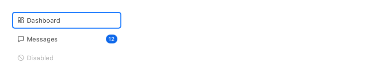

```python
from fluent_blue import SidebarItem, Stack

demo = Stack([SidebarItem("Dashboard", icon="dashboard"), SidebarItem("Messages", icon="message", badge=12),
              SidebarItem("Disabled", icon="ban", disabled=True)], spacing=1)
demo.setFixedWidth(220)
```

**Properties**

| Name | Default | Description |
| --- | --- | --- |
| `text` | `required` | Label. |
| `parent` | `None` | Parent widget. |
| `key` | `None` | Identifier reported by Sidebar.current_changed; defaults to text. |
| `icon` | `None` | Icon name. |
| `badge` | `None` | Optional count or short text drawn at the right edge. |
| `disabled` | `False` | Start disabled. |
| `tooltip` | `None` | Tooltip text; the sidebar uses the label when collapsed. |

**Best practices**

- Usually created through Sidebar.add_item.
- Use the badge for counts that need attention.

[AI brief for SidebarItem](../ai/components/SidebarItem.md){ .md-button }

## NavigationBar

A horizontal application bar with title, start, center and end regions.

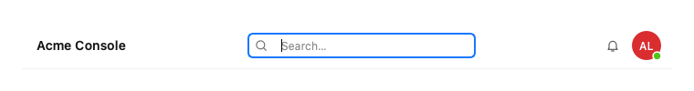

```python
from fluent_blue import Avatar, IconButton, NavigationBar, SearchInput

demo = NavigationBar("Acme Console")
demo.add_center(SearchInput(size="small"))
demo.add_end(IconButton("bell", tooltip="Notifications"))
demo.add_end(Avatar("Ada Lovelace", status="online"))
```

**Properties**

| Name | Default | Description |
| --- | --- | --- |
| `title` | `''` | Optional title text. |
| `parent` | `None` | Parent widget. |
| `height` | `52` | Bar height in pixels. |

**Best practices**

- Keep global actions here, and page actions in the page header.

[AI brief for NavigationBar](../ai/components/NavigationBar.md){ .md-button }

## Breadcrumb

A trail of links to parent locations; the last entry is the current page.

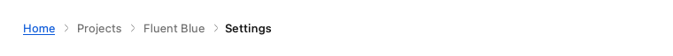

```python
from fluent_blue import Breadcrumb

demo = Breadcrumb(["Home", "Projects", "Fluent Blue", "Settings"])
```

**Properties**

| Name | Default | Description |
| --- | --- | --- |
| `items` | `None` | Labels from root to current. |
| `parent` | `None` | Parent widget. |

**Signals**

- `item_clicked(int, str)`: Index and label of the activated ancestor.

**Best practices**

- Show where the current page sits in a deep hierarchy, not the history.

[AI brief for Breadcrumb](../ai/components/Breadcrumb.md){ .md-button }

## Tabs

Tabbed pages built on QTabWidget, using TabBar.

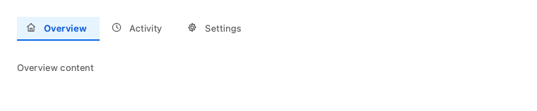

```python
from fluent_blue import Tabs, Text

demo = Tabs()
demo.add_tab(Text("Overview content", color="text-secondary"), "Overview", icon="home")
demo.add_tab(Text("Activity content", color="text-secondary"), "Activity", icon="clock")
demo.add_tab(Text("Settings content", color="text-secondary"), "Settings", icon="settings")
demo.setMinimumHeight(110)
```

**Properties**

| Name | Default | Description |
| --- | --- | --- |
| `parent` | `None` | Parent widget. |
| `closable` | `False` | Show close buttons on tabs. |

**Best practices**

- Each tab should be a peer view of the same subject.

[AI brief for Tabs](../ai/components/Tabs.md){ .md-button }

## TabBar

A standalone tab strip with an underline indicator.

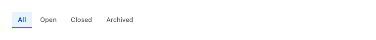

```python
from fluent_blue import TabBar

demo = TabBar(["All", "Open", "Closed", "Archived"])
```

**Properties**

| Name | Default | Description |
| --- | --- | --- |
| `tabs` | `None` | Initial tab labels. |
| `parent` | `None` | Parent widget. |
| `closable` | `False` | Show close buttons. |

**Best practices**

- Use the bare strip to drive your own content, such as a filtered list.

[AI brief for TabBar](../ai/components/TabBar.md){ .md-button }

## Pagination

Page navigation with ellipsis and optional range text.

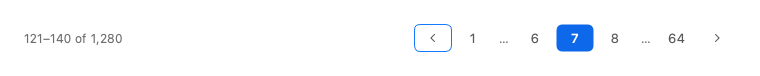

```python
from fluent_blue import Pagination

demo = Pagination(total=1280, page_size=20, page=7)
```

**Properties**

| Name | Default | Description |
| --- | --- | --- |
| `parent` | `None` | Parent widget. |
| `total` | `0` | Number of items. |
| `page_size` | `10` | Items per page. |
| `page` | `1` | Current 1-based page. |
| `siblings` | `1` | Pages shown on each side of the current one. |
| `show_total` | `True` | Show "1-10 of 200". |

**Signals**

- `page_changed(int)`: The new 1-based page.

**Best practices**

- Show the range so people know how much data exists.

[AI brief for Pagination](../ai/components/Pagination.md){ .md-button }

## Menu

A popup menu.

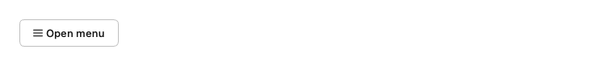

```python
from fluent_blue import Button, Menu

demo = Button("Open menu", icon="menu")
menu = Menu(demo, items=[
    {"text": "New file", "icon": "file", "shortcut": "Ctrl+N"},
    {"text": "Open…", "icon": "folder-open", "shortcut": "Ctrl+O"},
    None,
    {"text": "Export", "items": ["PDF", "CSV", "JSON"]},
    {"text": "Show hidden files", "checkable": True, "checked": True},
    None,
    {"text": "Delete", "icon": "trash", "danger": True},
])
demo.clicked.connect(lambda: menu.popup(demo.mapToGlobal(demo.rect().bottomLeft())))
```

**Properties**

| Name | Default | Description |
| --- | --- | --- |
| `parent` | `None` | Parent widget. |
| `items` | `None` | A list of str, MenuItem, dict (MenuItem keyword arguments plus text, optional items for a submenu) or None for a separator. |
| `title` | `''` | Title when used as a submenu. |

**Signals**

- `item_triggered(str)`: The id of the chosen entry.

**Best practices**

- Keep menus short and put destructive entries last, after a separator.

[AI brief for Menu](../ai/components/Menu.md){ .md-button }

## MenuItem

A menu entry.

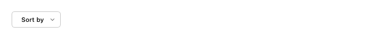

```python
from fluent_blue import Button, Menu, MenuItem

demo = Button("Sort by")
menu = Menu(demo)
menu.add_item(MenuItem("Name", menu, icon="type", checkable=True, checked=True))
menu.add_item(MenuItem("Date", menu, icon="calendar", checkable=True))
demo.setMenu(menu)
```

**Properties**

| Name | Default | Description |
| --- | --- | --- |
| `text` | `required` | Label. |
| `parent` | `None` | Owning object. |
| `id` | `None` | Value reported by Menu.item_triggered; defaults to text. |
| `icon` | `None` | Icon name. |
| `shortcut` | `None` | Shortcut text such as "Ctrl+S". |
| `checkable` | `False` | Toggle behavior. |
| `checked` | `False` | Initial checked state. |
| `disabled` | `False` | Start disabled. |
| `danger` | `False` | Use the error color for the icon of a destructive action. |

**Best practices**

- Create one directly for full control, such as keeping a reference to toggle it.

[AI brief for MenuItem](../ai/components/MenuItem.md){ .md-button }

## DropdownMenu

A button that opens a Menu.

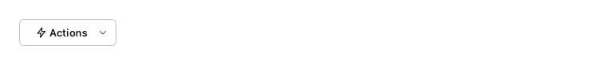

```python
from fluent_blue import DropdownMenu

demo = DropdownMenu("Actions", items=[
    {"text": "Rename", "icon": "edit"},
    {"text": "Duplicate", "icon": "copy"},
    None,
    {"text": "Archive", "icon": "archive"},
], icon="zap")
```

**Properties**

| Name | Default | Description |
| --- | --- | --- |
| `text` | `''` | Button label. |
| `parent` | `None` | Parent widget. |
| `items` | `None` | Menu entries. |
| `variant` | `None` | primary, secondary, outline, ghost, text or danger. |
| `size` | `'medium'` | small, medium or large. |
| `icon` | `None` | Icon name or QIcon. |
| `icon_position` | `'left'` | left or right. |
| `loading` | `False` | Show a spinner and ignore clicks. |
| `disabled` | `False` | Start disabled. |
| `full_width` | `False` | Expand to fill the available width. |
| `tooltip` | `None` | Tooltip text. |

**Signals**

- `item_triggered(str)`: The id of the chosen entry.

**Best practices**

- Connect item_triggered and branch on the item id.

[AI brief for DropdownMenu](../ai/components/DropdownMenu.md){ .md-button }

## CommandPalette

A searchable command launcher.

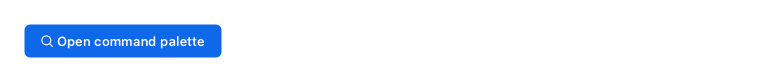

```python
from fluent_blue import Button, Command, CommandPalette, Toast

demo = Button("Open command palette", icon="search", variant="primary")
palette = CommandPalette(demo, shortcut=None, commands=[
    Command("new", "New project", "Create an empty project", "plus"),
    Command("theme", "Switch theme", "Light or dark", "palette"),
    Command("docs", "Open documentation", icon="file-text"),
])
palette.command_triggered.connect(lambda cid: Toast.show(f"Ran: {cid}", parent=demo, variant="success"))
demo.clicked.connect(palette.open_palette)
```

**Properties**

| Name | Default | Description |
| --- | --- | --- |
| `parent` | `None` | Window the palette opens over and listens on for the shortcut. |
| `commands` | `None` | Initial Command objects. |
| `shortcut` | `'Ctrl+K'` | Global shortcut, or None for none. |
| `placeholder` | `'Type a command or search…'` | Search placeholder. |

**Signals**

- `command_triggered(str)`: The id of the chosen command.

**Best practices**

- Pass a window as the parent and keep the default Ctrl+K shortcut.
- Add keywords, because people search with their own words.

[AI brief for CommandPalette](../ai/components/CommandPalette.md){ .md-button }
