# Selection

Choose from options with the control that suits the choice.

Every example below is executed by the test suite on PyQt6 and PySide6, in each built-in theme.

## Select

Choose one value from a list.

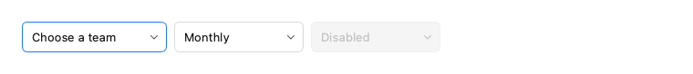

```python
from fluent_blue import Select, Stack

demo = Stack([
    Select(["Design", "Engineering", "Marketing"], placeholder="Choose a team"),
    Select([("Weekly", 7), ("Monthly", 30)], value=30),
    Select(["Disabled"], disabled=True),
], direction="horizontal")
```

**Properties**

| Name | Default | Description |
| --- | --- | --- |
| `options` | `None` | "a", ("Label", value) or {"label": ..., "value": ...} entries. |
| `parent` | `None` | Parent widget. |
| `value` | `None` | Initial value. |
| `placeholder` | `''` | Text shown while nothing is selected. |
| `size` | `'medium'` | small, medium or large. |
| `disabled` | `False` | Start disabled. |
| `tooltip` | `None` | Tooltip text. |

**Signals**

- `value_changed(object)`: The newly selected value.

**Best practices**

- Prefer it over radio buttons when there are more than five options.

[AI brief for Select](../ai/components/Select.md){ .md-button }

## MultiSelect

Choose any number of values from a checkable popup list.

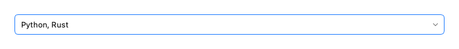

```python
from fluent_blue import MultiSelect

demo = MultiSelect(["Python", "Rust", "Go", "TypeScript"], values=["Python", "Rust"], placeholder="Languages")
```

**Properties**

| Name | Default | Description |
| --- | --- | --- |
| `options` | `None` | Entries, in the same forms as Select. |
| `parent` | `None` | Parent widget. |
| `values` | `None` | Initially selected values. |
| `placeholder` | `'Select…'` | Text shown while nothing is selected. |
| `max_labels` | `2` | Labels listed before the text collapses to a count. |
| `disabled` | `False` | Start disabled. |

**Signals**

- `values_changed(list)`: The selected values, in option order.

**Best practices**

- The label collapses to a count, so the control keeps its width.

[AI brief for MultiSelect](../ai/components/MultiSelect.md){ .md-button }

## ComboBox

An editable Select with type-ahead; free text is allowed.

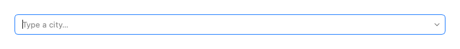

```python
from fluent_blue import ComboBox

demo = ComboBox(["Amsterdam", "Berlin", "Copenhagen", "Dublin", "Hanoi"], placeholder="Type a city…")
```

**Properties**

| Name | Default | Description |
| --- | --- | --- |
| `options` | `None` | "a", ("Label", value) or {"label": ..., "value": ...} entries. |
| `parent` | `None` | Parent widget. |
| `placeholder` | `''` | Text shown while nothing is selected. |
| `value` | `None` | Initial value. |
| `size` | `'medium'` | small, medium or large. |
| `disabled` | `False` | Start disabled. |
| `tooltip` | `None` | Tooltip text. |

**Signals**

- `value_changed(object)`: The selected value, or the free text entered.

**Best practices**

- Use when free text is valid or the list is long enough to need search.

[AI brief for ComboBox](../ai/components/ComboBox.md){ .md-button }

## Checkbox

A checkbox, with optional indeterminate state.

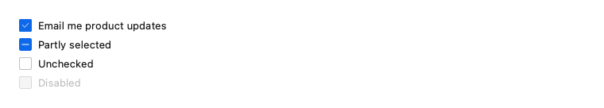

```python
from fluent_blue import Checkbox, Stack

demo = Stack([
    Checkbox("Email me product updates", checked=True),
    Checkbox("Partly selected", indeterminate=True),
    Checkbox("Unchecked"),
    Checkbox("Disabled", disabled=True),
])
```

**Properties**

| Name | Default | Description |
| --- | --- | --- |
| `text` | `''` | Label. |
| `parent` | `None` | Parent widget. |
| `checked` | `False` | Initial state. |
| `indeterminate` | `False` | Start in the mixed state; also enables tristate cycling. |
| `disabled` | `False` | Start disabled. |
| `tooltip` | `None` | Tooltip text. |

**Signals**

- Inherits toggled(bool) and stateChanged(int) from QCheckBox.

**Best practices**

- Use for independent choices that are applied together, such as in a form.

[AI brief for Checkbox](../ai/components/Checkbox.md){ .md-button }

## RadioButton

A radio button. Use RadioGroup for the common case.

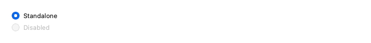

```python
from fluent_blue import RadioButton, Stack

demo = Stack([RadioButton("Standalone", checked=True), RadioButton("Disabled", disabled=True)])
```

**Properties**

| Name | Default | Description |
| --- | --- | --- |
| `text` | `''` | Label. |
| `parent` | `None` | Parent widget. |
| `checked` | `False` | Initial state. |
| `disabled` | `False` | Start disabled. |
| `tooltip` | `None` | Tooltip text. |

**Best practices**

- Most of the time RadioGroup is what you want.

[AI brief for RadioButton](../ai/components/RadioButton.md){ .md-button }

## RadioGroup

A set of mutually exclusive radio buttons.

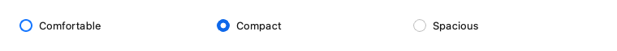

```python
from fluent_blue import RadioGroup

demo = RadioGroup([("Comfortable", "comfortable"), ("Compact", "compact"), ("Spacious", "spacious")],
                  value="compact", orientation="horizontal")
```

**Properties**

| Name | Default | Description |
| --- | --- | --- |
| `options` | `None` | Entries, in the same forms as Select. |
| `parent` | `None` | Parent widget. |
| `value` | `None` | Initial value. |
| `orientation` | `'vertical'` | vertical or horizontal. |
| `disabled` | `False` | Start disabled. |

**Signals**

- `value_changed(object)`: The newly selected value.

**Best practices**

- Show all options at once when comparison matters and there are few.

[AI brief for RadioGroup](../ai/components/RadioGroup.md){ .md-button }

## Switch

An animated on/off toggle.

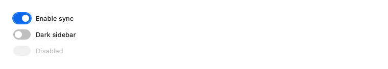

```python
from fluent_blue import Stack, Switch

demo = Stack([Switch("Enable sync", checked=True), Switch("Dark sidebar"), Switch("Disabled", disabled=True)])
```

**Properties**

| Name | Default | Description |
| --- | --- | --- |
| `text` | `''` | Optional label to the right of the track. |
| `parent` | `None` | Parent widget. |
| `checked` | `False` | Initial state. |
| `disabled` | `False` | Start disabled. |
| `tooltip` | `None` | Tooltip text. |

**Signals**

- Inherits toggled(bool) from QAbstractButton.

**Best practices**

- A switch takes effect immediately; use a Checkbox if a Save button follows.

[AI brief for Switch](../ai/components/Switch.md){ .md-button }

## SegmentedControl

A compact, mutually exclusive option strip.

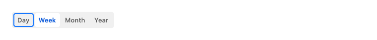

```python
from fluent_blue import SegmentedControl

demo = SegmentedControl(["Day", "Week", "Month", "Year"], value="Week")
```

**Properties**

| Name | Default | Description |
| --- | --- | --- |
| `options` | `None` | Entries, in the same forms as Select. |
| `parent` | `None` | Parent widget. |
| `value` | `None` | Initial value; defaults to the first option. |
| `disabled` | `False` | Start disabled. |

**Signals**

- `value_changed(object)`: The newly selected value.

**Best practices**

- Ideal for switching views of the same content; keep to about five options.

[AI brief for SegmentedControl](../ai/components/SegmentedControl.md){ .md-button }

## Slider

A value slider.

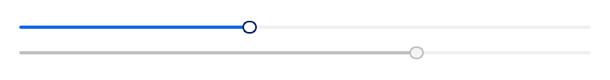

```python
from fluent_blue import Slider, Stack

demo = Stack([Slider(40), Slider(70, disabled=True)], spacing=3)
```

**Properties**

| Name | Default | Description |
| --- | --- | --- |
| `value` | `0` | Initial value. |
| `parent` | `None` | Parent widget. |
| `minimum` | `0` | Lower bound. |
| `maximum` | `100` | Upper bound. |
| `step` | `1` | Single-step amount for arrow keys. |
| `orientation` | `'horizontal'` | horizontal or vertical. |
| `disabled` | `False` | Start disabled. |
| `tooltip` | `None` | Tooltip text. |

**Signals**

- Inherits valueChanged(int) and sliderReleased from QSlider.

**Best practices**

- Use when the approximate value matters; use NumberInput for exact values.

[AI brief for Slider](../ai/components/Slider.md){ .md-button }

## SpinBox

An integer input with stepper buttons.

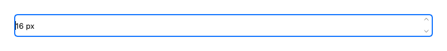

```python
from fluent_blue import SpinBox

demo = SpinBox(16, minimum=8, maximum=72, suffix=" px")
```

**Properties**

| Name | Default | Description |
| --- | --- | --- |
| `value` | `0` | Initial value. |
| `parent` | `None` | Parent widget. |
| `minimum` | `0` | Lower bound. |
| `maximum` | `100` | Upper bound. |
| `step` | `1` | Step amount. |
| `suffix` | `''` | Text after the value, such as " px". |
| `disabled` | `False` | Start disabled. |
| `tooltip` | `None` | Tooltip text. |

**Signals**

- Inherits valueChanged(int) from QSpinBox.

**Best practices**

- Add a suffix so that the unit is never ambiguous.

[AI brief for SpinBox](../ai/components/SpinBox.md){ .md-button }

## Rating

A star rating that can be set with the mouse or the keyboard.

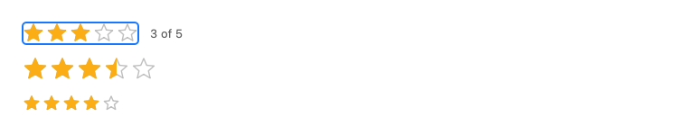

```python
from fluent_blue import Rating, Stack, Text, Toast

live = Rating(3)
caption = Text("3 of 5", color="text-secondary")
live.value_changed.connect(lambda value: caption.setText(f"{value:g} of 5"))
demo = Stack([
    Stack([live, caption], direction="horizontal", align="center", spacing=3),
    Rating(3.5, allow_half=True, size=26),
    Rating(4, read_only=True, size=18),
], spacing=3)
```

**Properties**

| Name | Default | Description |
| --- | --- | --- |
| `value` | `0` | Initial value from 0 to count. |
| `parent` | `None` | Parent widget. |
| `count` | `5` | Number of stars. |
| `allow_half` | `False` | Allow half-star values. |
| `allow_clear` | `True` | Clicking the current value again resets it to 0. |
| `read_only` | `False` | Display only; the value cannot be changed by the user. |
| `size` | `22` | Star size in pixels. |
| `disabled` | `False` | Start disabled. |
| `tooltip` | `None` | Tooltip text. |

**Signals**

- `value_changed(float)`: The new value, after a change by the user or by set_value.

**Best practices**

- Use half stars only when the average is shown with that precision.
- Clicking the current value again clears it; pass allow_clear=False to prevent that.
- Set read_only=True to display an average rating.

[AI brief for Rating](../ai/components/Rating.md){ .md-button }

## RangeSlider

A slider with two handles that selects a range.

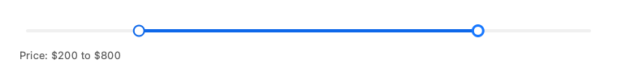

```python
from fluent_blue import RangeSlider, Stack, Text

readout = Text("Price: $200 to $800", color="text-secondary")
slider = RangeSlider(200, 800, minimum=0, maximum=1000, step=50)
slider.range_changed.connect(lambda low, high: readout.setText(f"Price: ${low} to ${high}"))
demo = Stack([slider, readout], spacing=2)
```

**Properties**

| Name | Default | Description |
| --- | --- | --- |
| `low` | `20` | Initial lower value. |
| `high` | `80` | Initial upper value. |
| `parent` | `None` | Parent widget. |
| `minimum` | `0` | Lowest allowed value. |
| `maximum` | `100` | Highest allowed value. |
| `step` | `1` | Granularity of values. |
| `disabled` | `False` | Start disabled. |
| `tooltip` | `None` | Tooltip text. |

**Signals**

- `range_changed(int, int)`: The new lower and upper values.

**Best practices**

- Show the chosen range in text next to the slider.
- Use step to avoid meaningless precision.
- Up and Down choose the handle, Left and Right move it.

[AI brief for RangeSlider](../ai/components/RangeSlider.md){ .md-button }
