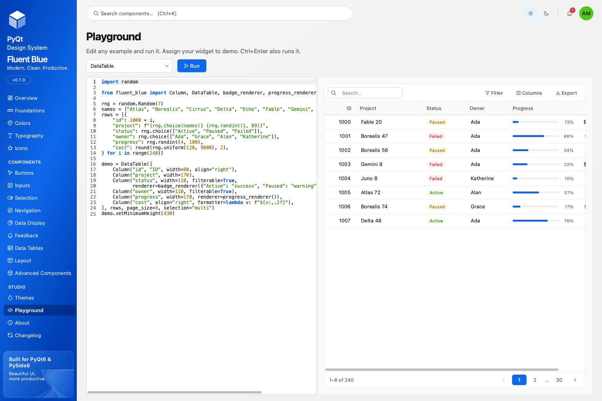

# Examples

Complete applications live in the `examples/` directory of the repository. Each file exposes `build()`, which returns the root widget, and `main()`, which runs it. The test suite constructs every example headlessly on both bindings.

```bash
python examples/projects_app.py
```

| File | What it shows |
| --- | --- |
| `basic_app.py` | The smallest useful app: a card with an input, a primary button, a badge and a toast. |
| `projects_app.py` | The [tutorial](getting-started.md): sidebar, `DataTable`, a drawer form with validation, confirm dialog, snackbar with undo, theme toggle. |
| `dashboard.py` | `NavigationBar`, `StatisticCard` with sparklines, `Timeline` and a live `LogViewer`. |
| `forms.py` | `FormField` validation, `PasswordInput`, `Select`, `DatePicker`, `RadioGroup`, `TextArea`, `Switch` and `MessageDialog`. |
| `data_table.py` | 5,000 rows with renderers, filters, multi-selection and CSV export. |
| `advanced_components.py` | `CodeEditor`, `Wizard`, `Calendar`, `TimePicker`, `ColorPicker`, `FilePicker`, `TreeView` and `RichTextEditor` in tabs. |

## Design Studio Playground

Design Studio's Playground runs any catalog example as editable code. Pick a component, change the snippet, press **Run** or ++ctrl+enter++. The snippet must assign a widget to `demo`.


