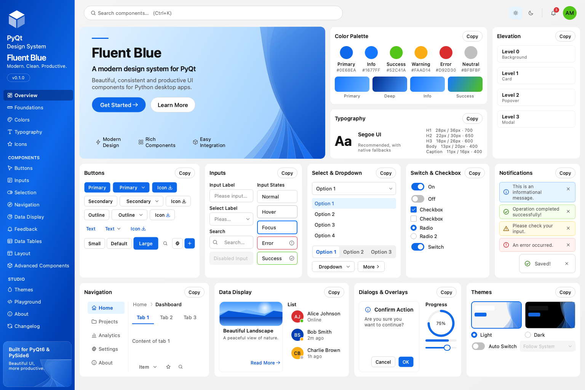

# Fluent Blue

A modern, token-driven design system for Python desktop applications. One code base, two bindings: **PyQt6** and **PySide6**.

Fluent Blue gives a Qt application the consistency of a real design system: a central set of design tokens, a runtime theme engine, an original icon set, and 103 components that all read from the same tokens. It ships with **Design Studio**, an interactive showcase where every example is a live widget, and with briefs that let AI coding agents use the library without inventing APIs.

## Start here

- **[Installation](installation.md)**: pick a binding and open Design Studio in two commands.
- **[Quick start and tutorial](getting-started.md)**: build a small Projects app in five steps.
- **[Components](components/index.md)**: every component with a screenshot, a verified example and its API.
- **[Theming](theming.md)**: light, dark, high contrast, your own brand, and system following.

## What you get

| | |
| --- | --- |
| **Design tokens** | Color, typography, spacing, radius, elevation and motion, configured in one place. |
| **Theme engine** | Switch at runtime; every open window follows in about 80 ms. Register custom themes from one primary color. |
| **103 components** | From `Button` to `DataTable`, `CommandPalette`, `CodeEditor`, `DatePicker`, `ColorPicker`, `Wizard` and `RichTextEditor`. |
| **Original icons** | 131 SVG icons on a 24 px grid, recolored by the theme. |
| **Accessibility** | Every text pairing meets WCAG AA, enforced by tests. Keyboard access and visible focus throughout. |
| **Quality gates** | 748 tests on both bindings, a UI audit that measures clipped text, overlaps and contrast, and a performance report. |
| **AI-ready** | A generated brief per component, so coding assistants work from the real API. |

## Compatibility

Verified with Python 3.11 and 3.13 on Qt 6.12 (PyQt6 6.12.0 and PySide6 6.12.0). Qt 6.5 and later should work, but only the versions above are exercised by the test suite.

## License

MIT. The icon set and artwork are original, and the project is independent of Microsoft, The Qt Company, Riverbank Computing and Ant Group. The primary blue scale overlaps with values from Ant Design's MIT-licensed palette.
