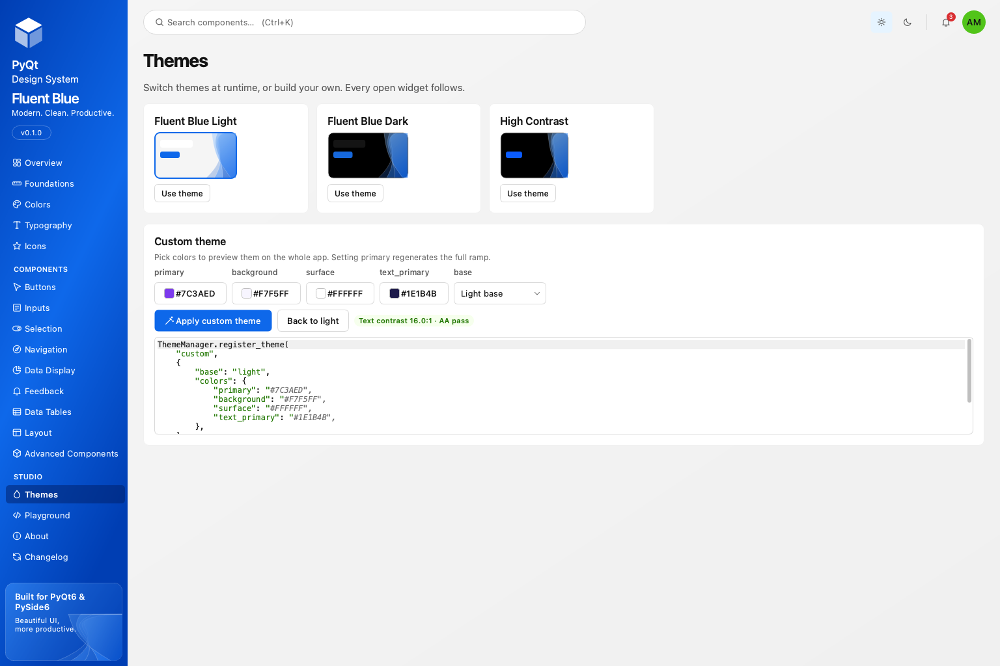

# Theming

`ThemeManager` is a process-wide engine. It generates one application stylesheet per theme, applies it once, and tells custom-painted widgets to refresh. A switch restyles every open window in a single pass.

## Built-in themes

| Name | Description |
| --- | --- |
| `light` | Fluent Blue Light: white and light-blue surfaces, deep navy text. The default. |
| `dark` | Fluent Blue Dark: graphite surfaces with the same brand accent. |
| `high-contrast` | Black surfaces, white text, a yellow focus ring, for accessibility settings. |
| `system` | Not a theme of its own: follows the operating system between `light` and `dark`, and reacts when it changes. |

```python
from fluent_blue import ThemeManager

ThemeManager.set_theme("dark")
ThemeManager.toggle()                      # light <-> dark, returns the new name
ThemeManager.set_theme("system")
ThemeManager.current()                     # "light"
ThemeManager.is_dark()
ThemeManager.themes()                      # ["light", "dark", "high-contrast", ...]
ThemeManager.theme_changed.connect(lambda name: print("now", name))
```

You do not have to call `set_theme` at all: the first component applies the light theme to the application.

## Custom themes

`register_theme` takes a base theme and overrides. Overriding `primary` regenerates the whole primary ramp and every interactive primary role, so a brand needs one line. Text roles can use underscores or hyphens.

```python
ThemeManager.register_theme(
    "custom",
    {
        "base": "light",                   # or "dark"; defaults to "light"
        "label": "Acme Light",
        "colors": {
            "primary": "#1677FF",
            "background": "#F5F8FF",
            "text_primary": "#172554",
        },
        "tokens": {"radius": {"lg": 10}},
    },
)
ThemeManager.set_theme("custom")
```

Re-registering a name replaces the theme; if it is active, open windows update at once. `unregister_theme` removes a custom theme.



The Themes page of Design Studio builds the same call interactively and shows the contrast of your text and surface choices.

## Global settings

```python
from fluent_blue import configure

configure(font_scale=1.2)                  # scale every type role
configure(animations=False)                # reduced motion
configure(use_fusion_style=False)          # keep the platform style instead of Fusion
```

Fluent Blue uses Qt's Fusion style by default, because it gives stylesheets identical metrics on every platform.

## Theme-aware custom widgets

Read token colors at paint time, and subclass `ThemedMixin` when something is cached:

```python
from fluent_blue import ThemeManager
from fluent_blue.compatibility.qt import QPainter, QWidget
from fluent_blue.components.base import ThemedMixin
from fluent_blue.icons import icon_pixmap


class Gauge(ThemedMixin, QWidget):
    def __init__(self, parent=None):
        super().__init__(parent)
        self.bind_theme()                  # calls refresh_theme() after each switch
        self.refresh_theme()

    def refresh_theme(self):
        self._icon = icon_pixmap("zap", 16, "primary-text")   # rebuilt per theme

    def paintEvent(self, event):
        painter = QPainter(self)
        painter.fillRect(self.rect(), ThemeManager.qcolor("surface-secondary"))
        painter.setPen(ThemeManager.qcolor("text-primary"))
        painter.setFont(ThemeManager.font("label"))
        painter.drawText(self.rect(), 0x84, "42%")
        painter.drawPixmap(8, 8, self._icon)
        painter.end()
```

Never connect a lambda that captures a widget to `theme_changed`: the connection outlives the widget. `bind_theme()` uses a bound method and skips hidden widgets until they are shown again, which keeps switches fast.

## Styling with stylesheets

Components carry no stylesheets of their own; rules live in `fluent_blue/themes/stylesheet/` and select on class names and dynamic properties (`Button[variant="primary"]`, `Input[validation="error"]`). To style a component differently, prefer a prop or a token override. If you must add rules, set them on the application after `set_theme`, and expect to reapply them on `theme_changed`.
