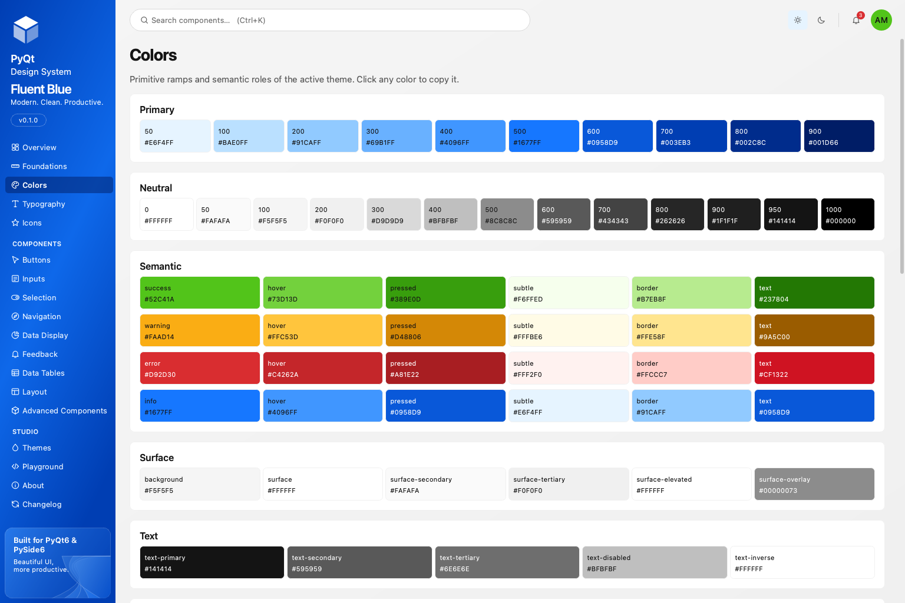

# Design tokens

Tokens are the single source of every visual value. They live in `fluent_blue.core.tokens` (theme-independent) and `fluent_blue.core.palette` (color roles per theme), and are read through `ThemeManager`.

```python
from fluent_blue import ThemeManager

ThemeManager.color("primary")          # "#0E68EA"
ThemeManager.qcolor("text-secondary")  # QColor
ThemeManager.spacing(4)                # 16
ThemeManager.radius("lg")              # 8
ThemeManager.font("heading-2")         # QFont
ThemeManager.shadow(2)                 # Shadow(offset_y=3, blur=14, alpha=0.16)
ThemeManager.duration("normal")        # 160, or 0 when animations are off
ThemeManager.tokens                    # the DesignTokens object of the active theme
```

## Color

Primitive ramps give raw values; semantic roles give meaning. Components use roles.

| Group | Roles |
| --- | --- |
| Primary ramp | `primary-50` to `primary-900` |
| Neutral ramp | `gray-0` to `gray-1000` |
| Brand roles | `primary`, `primary-hover`, `primary-pressed`, `primary-subtle`, `primary-subtle-hover`, `primary-border`, `primary-text`, `on-primary` |
| Semantic | `success`, `warning`, `error`, `info`, each with `-hover`, `-pressed`, `-subtle`, `-border`, `-text` and `on-` variants |
| Surface | `background`, `surface`, `surface-secondary`, `surface-tertiary`, `surface-elevated`, `surface-overlay` |
| Text | `text-primary`, `text-secondary`, `text-tertiary`, `text-disabled`, `text-inverse` |
| Border | `border`, `border-subtle`, `border-strong`, `border-focus` |
| Controls | `control`, `control-hover`, `control-pressed`, `control-disabled`, `ghost-hover`, `ghost-pressed`, `selection`, `selection-text` |

Roles accept underscores as well as hyphens (`text_primary` equals `text-primary`). The Colors page of Design Studio lists every role of the active theme with its value and the WCAG ratio of the key pairs; click a swatch to copy it.



## Typography

Segoe UI on Windows, the system font on macOS, and Inter, Noto Sans, Ubuntu or Cantarell elsewhere. Sizes are pixels and scale with `configure(font_scale=…)`.

| Role | Size / line | Weight |
| --- | --- | --- |
| `display` | 36 / 44 | 700 |
| `heading-1` to `heading-6` | 28/36, 22/30, 18/26, 16/24, 14/20, 13/18 | 700 to 600 |
| `body-large`, `body-medium`, `body-small` | 15/24, 13/20, 12/18 | 400 |
| `caption` | 11 / 16 | 400 |
| `label`, `button` | 12/16, 13/16 | 500 |
| `monospace` | 12 / 18 | 400, Cascadia Code, Consolas, SF Mono, Menlo, JetBrains Mono |

Use them through `Text(…, style="heading-2")` or `ThemeManager.font("label")`.

## Spacing

A 4 px scale: steps `0, 1, 2, 3, 4, 5, 6, 8, 10, 12, 16, 20` give `0, 4, 8, 12, 16, 20, 24, 32, 40, 48, 64, 80` px. `Stack`, `Grid`, `Container` and `Panel` take steps, not pixels.

## Radius

`none` 0, `xs` 2, `sm` 4, `md` 6, `lg` 8, `xl` 12, `full` 999. Controls use `md`, cards use `lg`, dialogs use `xl`.

## Elevation

Levels 0 to 4 define a drop shadow (offset, blur, alpha) that `Card(elevation=…)` and overlays apply through `apply_elevation`. Level 0 is flat, level 1 is a card, level 2 a popover, level 3 a menu, level 4 a modal.

## Motion

`duration-fast` 90 ms, `duration-normal` 160 ms, `duration-slow` 260 ms, `easing-standard` (out-cubic) and `easing-emphasized` (out-quint). `configure(animations=False)` makes every animation jump to its end state.

## Control heights and icon sizes

`small` 28 px, `medium` 34 px, `large` 40 px. Icon sizes `xs` 12, `small` 14, `medium` 16, `large` 20, `xl` 24, `xxl` 40.

## Overriding tokens

Any group can be overridden per theme:

```python
ThemeManager.register_theme("compact", {
    "base": "light",
    "tokens": {
        "radius": {"md": 4, "lg": 6},
        "control_height": {"small": 24, "medium": 30, "large": 36},
        "typography": {"body-medium": {"size": 12, "line_height": 18}},
    },
})
```
